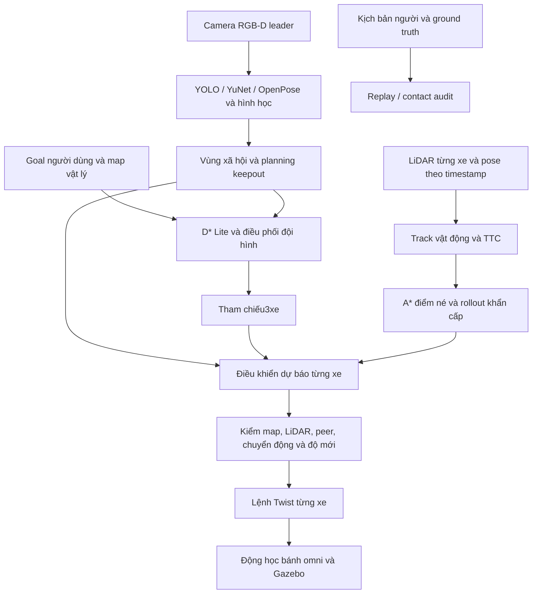

# Three Robot Rescue — D* Lite + MPC và điều hướng xã hội

> NK174 khôi phục baseline theo lượt `dynamic_20261104_111606_125384942`.
> Sáu SHA nguồn trong diagnostics_config.json khớp snapshot. LiDAR12m/5,5Hz theo NK177; camera chủ động xác nhận cụm gần đường trong3m.
> Lượt cũ có ghi nhận robot2 chưa nối lại đội hình. Chưa build/chạy lại bản khôi phục.

Mỗi phần dưới đây có bộ lệnh độc lập: **vào thư mục → build → source → chạy**.
Chỉ sao chép phần cần dùng. Máy cần ROS 2 Humble, Gazebo Fortress, colcon
và các phụ thuộc khai báo trong hai package; các lệnh giả định dự án ở
`~/three-robot-rescue`, thay đường dẫn nếu bạn clone ở nơi khác.

Các chế độ còn giữ: **động, tĩnh; Paper1,2,3,4,5,6,7,8**. Các số paper
được giữ để đối chiếu bản ghi cũ. Paper5 cần chuẩn bị thư viện HO-MPC theo
khối lệnh riêng; Paper6/10 là chế độ từ repository dự án. Các bản chuyển
đổi mới chưa được xác nhận chạy ổn qua Gazebo.

Đánh số hiện hành: Paper5 = HO-MPC; Paper6 = Different Drivetrains;
Paper7 = Robile; Paper8 = DEFORM. Từ NK123 dùng số mới trong lệnh chạy;
bản ghi cũ phải đối chiếu tên thuật toán/repository, không chỉ số paper.

Tra cứu nhanh: [bảng thống kê thuật toán](#bảng-thống-kê-công-trình-và-thuật-toán), [thuật toán và nguồn gốc](#6-thuật-toán-thực-sự-có-trong-dự-án-và-nguồn-gốc),
[cây file nguồn](#7-cây-thư-mục-từ-workspace-tới-từng-file-nguồn),
[danh mục minh chứng](docs/DANH_MUC_THU_MUC_VA_FILE.md).

Chỉ mở một phiên mô phỏng mỗi lượt. Trong RViz chọn **2D Goal Pose** để
đặt đích; `Ctrl+C` ở terminal chạy để dừng trước khi chọn chế độ khác.
Các lệnh để người dùng tự chạy; AI chỉ thực thi khi được yêu cầu rõ.
Mỗi bộ lệnh mô phỏng bên dưới **đã bao gồm ghi bản chạy**. Tên thư mục
có chế độ và thời gian, không dùng lại bản cũ. Sau khi dừng bằng Ctrl+C,
chạy dòng viewer ngay trong cùng bộ lệnh để xem lại. Muốn xem trong lúc
đang chạy, sao chép lệnh viewer có đường dẫn đầy đủ mà terminal in ra sang
terminal thứ hai. Thư mục chỉ xuất hiện trên máy thực sự chạy mô phỏng.

Từ NK098, viewer có bố cục thu gọn, camera dạng video và hai ô Gazebo/RViz
bên dưới. Wrapper ghi hai cửa sổ X11 thực khi có `ffmpeg`/`xwininfo`;
**giữ cửa sổ không thu nhỏ/đổi kích thước khi ghi**. Camera MP4 được chuẩn
bị sau Ctrl+C; video cửa sổ đồng bộ gần đúng, không dùng để đo thời điểm
contact thay JSONL. Bản cũ không có video Gazebo/RViz sẽ hiện thông báo.
[Chi tiết video và giới hạn](docs/PHAT_LAI_MO_PHONG.md#video-và-bố-cục-thu-gọn--nk098).

Chọn map để lấy trọn bộ lệnh của baseline và từng bài báo.

- [1. Map động](#1-map-động)
- [2. Map tĩnh](#2-map-tĩnh)
- [3. Map ngã tư ngoài trời](#3-map-ngã-tư-ngoài-trời)

## 1. Map động

Mỗi khối lệnh chạy độc lập trong một terminal và lưu một bản ghi mới.
Chọn goal bằng **2D Goal Pose** trong RViz. Sau Ctrl+C, lệnh viewer mở
đúng lượt vừa ghi.

### 1.0. Thuật toán của tôi — D* Lite + A* né + ba MPC

```bash
cd ~/three-robot-rescue
sudo apt install -y python3-numpy python3-scipy ffmpeg x11-utils
source /opt/ros/humble/setup.bash
colcon build --symlink-install \
  --base-paths social_navigation_planner social_navigation_sim \
  --packages-select social_navigation_planner social_navigation_sim \
  --cmake-args -DBUILD_TESTING=OFF
source install/setup.bash
export ROS_DOMAIN_ID=31
recording_dir="recordings/dynamic_$(date +%Y%m%d_%H%M%S_%N)"
bash scripts/run_simulation.sh dynamic --diagnose-stop "$recording_dir" \
  leader_camera:=true person_detection:=true head_pose_enabled:=true body_pose_enabled:=true social_avoidance:=true social_observation:=true social_auto_observe:=true
# Sau khi dừng mô phỏng bằng Ctrl+C, xem bản vừa ghi:
python3 scripts/view_replay.py --session "$recording_dir"
```

### 1.1. Paper1 — GWO–WOA + DWA

[Thuật toán, nguồn và giới hạn](README_PAPER1_GWO_WOA.md).

```bash
cd ~/three-robot-rescue
sudo apt install -y python3-numpy python3-scipy ffmpeg x11-utils
source /opt/ros/humble/setup.bash
colcon build --symlink-install \
  --base-paths social_navigation_planner social_navigation_sim \
  --packages-select social_navigation_planner social_navigation_sim \
  --cmake-args -DBUILD_TESTING=OFF
source install/setup.bash
export ROS_DOMAIN_ID=31
recording_dir="recordings/dynamic_paper1_$(date +%Y%m%d_%H%M%S_%N)"
bash scripts/run_simulation.sh paper1 --diagnose-stop "$recording_dir" social_scene:=dynamic
# Sau khi dừng mô phỏng bằng Ctrl+C, xem bản vừa ghi:
python3 scripts/view_replay.py --session "$recording_dir"
```

### 1.2. Paper2 — APF–MPC

[Thuật toán, nguồn và giới hạn](README_PAPER2_APF_MPC.md).

```bash
cd ~/three-robot-rescue
sudo apt install -y python3-numpy python3-scipy ffmpeg x11-utils
source /opt/ros/humble/setup.bash
colcon build --symlink-install \
  --base-paths social_navigation_planner social_navigation_sim \
  --packages-select social_navigation_planner social_navigation_sim \
  --cmake-args -DBUILD_TESTING=OFF
source install/setup.bash
export ROS_DOMAIN_ID=31
recording_dir="recordings/dynamic_paper2_$(date +%Y%m%d_%H%M%S_%N)"
bash scripts/run_simulation.sh paper2 --diagnose-stop "$recording_dir" social_scene:=dynamic
# Sau khi dừng mô phỏng bằng Ctrl+C, xem bản vừa ghi:
python3 scripts/view_replay.py --session "$recording_dir"
```

### 1.3. Paper3 — Pure Pursuit + Velocity Obstacles

[Thuật toán, nguồn và giới hạn](README_PAPER3_PURE_PURSUIT_VO.md).

```bash
cd ~/three-robot-rescue
sudo apt install -y python3-numpy python3-scipy ffmpeg x11-utils
source /opt/ros/humble/setup.bash
colcon build --symlink-install \
  --base-paths social_navigation_planner social_navigation_sim \
  --packages-select social_navigation_planner social_navigation_sim \
  --cmake-args -DBUILD_TESTING=OFF
source install/setup.bash
export ROS_DOMAIN_ID=31
recording_dir="recordings/dynamic_paper3_$(date +%Y%m%d_%H%M%S_%N)"
bash scripts/run_simulation.sh paper3 --diagnose-stop "$recording_dir" social_scene:=dynamic
# Ctrl+C để dừng, rồi xem đúng lượt vừa chạy:
python3 scripts/view_replay.py --session "$recording_dir"
```

### 1.4. Paper4 — Impedance / điều khiển trở kháng

[Thuật toán, nguồn và giới hạn](README_PAPER4_IMPEDANCE.md).

```bash
cd ~/three-robot-rescue
sudo apt install -y python3-numpy python3-scipy ffmpeg x11-utils
source /opt/ros/humble/setup.bash
colcon build --symlink-install \
  --base-paths social_navigation_planner social_navigation_sim \
  --packages-select social_navigation_planner social_navigation_sim \
  --cmake-args -DBUILD_TESTING=OFF
source install/setup.bash
export ROS_DOMAIN_ID=31
recording_dir="recordings/dynamic_paper4_$(date +%Y%m%d_%H%M%S_%N)"
bash scripts/run_simulation.sh paper4 --diagnose-stop "$recording_dir" social_scene:=dynamic
# Ctrl+C để dừng, rồi xem đúng lượt vừa chạy:
python3 scripts/view_replay.py --session "$recording_dir"
```

### 1.5. Paper5 — Hierarchical Optimization MPC

[Thuật toán, nguồn và giới hạn](README_PAPER5_HO_MPC.md).

```bash
cd ~/three-robot-rescue
sudo apt install -y git python3-venv python3-pip python3-numpy python3-scipy ffmpeg x11-utils
export SOCIAL_HO_MPC_ROOT="$HOME/.cache/three-robot-rescue/paper5"
python3 scripts/prepare_ho_mpc.py --directory "$SOCIAL_HO_MPC_ROOT"
python3 -m venv --system-site-packages "$SOCIAL_HO_MPC_ROOT/venv"
"$SOCIAL_HO_MPC_ROOT/venv/bin/python" -m pip install \
  'numpy<2' 'casadi>=3.6,<4' 'qpsolvers>=4,<5' quadprog matplotlib
paper5_site="$("$SOCIAL_HO_MPC_ROOT/venv/bin/python" -c 'import sysconfig; print(sysconfig.get_path("purelib"))')"
export PYTHONPATH="$paper5_site:${PYTHONPATH:-}"
source /opt/ros/humble/setup.bash
colcon build --symlink-install \
  --base-paths social_navigation_planner social_navigation_sim \
  --packages-select social_navigation_planner social_navigation_sim \
  --cmake-args -DBUILD_TESTING=OFF
source install/setup.bash
export ROS_DOMAIN_ID=31
recording_dir="recordings/dynamic_paper5_$(date +%Y%m%d_%H%M%S_%N)"
bash scripts/run_simulation.sh paper5 --diagnose-stop "$recording_dir" social_scene:=dynamic
# Chọn 2D Goal Pose trong RViz. Sau Ctrl+C, xem đúng lượt vừa chạy:
python3 scripts/view_replay.py --session "$recording_dir"
```

### 1.6. Paper6 — Formation Control with Different Drivetrains

[Thuật toán, nguồn và giới hạn](README_PAPER6_DIFFERENT_DRIVETRAINS.md).

```bash
cd ~/three-robot-rescue
sudo apt install -y python3-numpy python3-scipy ffmpeg x11-utils
source /opt/ros/humble/setup.bash
colcon build --symlink-install \
  --base-paths social_navigation_planner social_navigation_sim \
  --packages-select social_navigation_planner social_navigation_sim \
  --cmake-args -DBUILD_TESTING=OFF
source install/setup.bash
export ROS_DOMAIN_ID=31
recording_dir="recordings/dynamic_paper6_$(date +%Y%m%d_%H%M%S_%N)"
bash scripts/run_simulation.sh paper6 --diagnose-stop "$recording_dir" social_scene:=dynamic
# Chọn 2D Goal Pose trong RViz. Sau Ctrl+C, xem đúng lượt vừa chạy:
python3 scripts/view_replay.py --session "$recording_dir"
```

### 1.7. Paper7 — Robile Multi-Robot Formation

[Thuật toán, nguồn và giới hạn](README_PAPER7_ROBILE_FORMATION.md).

```bash
cd ~/three-robot-rescue
sudo apt install -y python3-numpy python3-scipy ffmpeg x11-utils
source /opt/ros/humble/setup.bash
colcon build --symlink-install \
  --base-paths social_navigation_planner social_navigation_sim \
  --packages-select social_navigation_planner social_navigation_sim \
  --cmake-args -DBUILD_TESTING=OFF
source install/setup.bash
export ROS_DOMAIN_ID=31
recording_dir="recordings/dynamic_paper7_$(date +%Y%m%d_%H%M%S_%N)"
bash scripts/run_simulation.sh paper7 --diagnose-stop "$recording_dir" social_scene:=dynamic
# Chọn 2D Goal Pose trong RViz. Sau Ctrl+C, xem đúng lượt vừa chạy:
python3 scripts/view_replay.py --session "$recording_dir"
```

### 1.8. Paper8 — DEFORM

[Thuật toán, nguồn và giới hạn](README_PAPER8_DEFORM.md).

```bash
cd ~/three-robot-rescue
sudo apt install -y python3-numpy python3-scipy ffmpeg x11-utils
source /opt/ros/humble/setup.bash
colcon build --symlink-install \
  --base-paths social_navigation_planner social_navigation_sim \
  --packages-select social_navigation_planner social_navigation_sim \
  --cmake-args -DBUILD_TESTING=OFF
source install/setup.bash
export ROS_DOMAIN_ID=31
recording_dir="recordings/dynamic_paper8_$(date +%Y%m%d_%H%M%S_%N)"
bash scripts/run_simulation.sh paper8 --diagnose-stop "$recording_dir" social_scene:=dynamic
# Ctrl+C để dừng, rồi xem đúng lượt vừa chạy:
python3 scripts/view_replay.py --session "$recording_dir"
```

### 1.9. Chỉ thử né vật động bằng LiDAR

```bash
cd ~/three-robot-rescue
sudo apt install -y python3-numpy python3-scipy ffmpeg x11-utils
source /opt/ros/humble/setup.bash
colcon build --symlink-install \
  --base-paths social_navigation_planner social_navigation_sim \
  --packages-select social_navigation_planner social_navigation_sim \
  --cmake-args -DBUILD_TESTING=OFF
source install/setup.bash
export ROS_DOMAIN_ID=31
recording_dir="recordings/dynamic_$(date +%Y%m%d_%H%M%S_%N)"
bash scripts/run_simulation.sh dynamic --diagnose-stop "$recording_dir"
# Sau khi dừng mô phỏng bằng Ctrl+C, xem bản vừa ghi:
python3 scripts/view_replay.py --session "$recording_dir"
```

## 2. Map tĩnh

Mỗi khối lệnh chạy độc lập trong một terminal và lưu một bản ghi mới.
Chọn goal bằng **2D Goal Pose** trong RViz. Sau Ctrl+C, lệnh viewer mở
đúng lượt vừa ghi.

### 2.0. Thuật toán của tôi — D* Lite + A* né + ba MPC

```bash
cd ~/three-robot-rescue
sudo apt install -y python3-numpy python3-scipy ffmpeg x11-utils
source /opt/ros/humble/setup.bash
colcon build --symlink-install \
  --base-paths social_navigation_planner social_navigation_sim \
  --packages-select social_navigation_planner social_navigation_sim \
  --cmake-args -DBUILD_TESTING=OFF
source install/setup.bash
export ROS_DOMAIN_ID=31
recording_dir="recordings/static_$(date +%Y%m%d_%H%M%S_%N)"
bash scripts/run_simulation.sh static --diagnose-stop "$recording_dir" \
  leader_camera:=true person_detection:=true head_pose_enabled:=true body_pose_enabled:=true social_avoidance:=true social_observation:=true social_auto_observe:=true
# Sau khi dừng mô phỏng bằng Ctrl+C, xem bản vừa ghi:
python3 scripts/view_replay.py --session "$recording_dir"
```

### 2.1. Paper1 — GWO–WOA + DWA

[Thuật toán, nguồn và giới hạn](README_PAPER1_GWO_WOA.md).

```bash
cd ~/three-robot-rescue
sudo apt install -y python3-numpy python3-scipy ffmpeg x11-utils
source /opt/ros/humble/setup.bash
colcon build --symlink-install \
  --base-paths social_navigation_planner social_navigation_sim \
  --packages-select social_navigation_planner social_navigation_sim \
  --cmake-args -DBUILD_TESTING=OFF
source install/setup.bash
export ROS_DOMAIN_ID=31
recording_dir="recordings/static_paper1_$(date +%Y%m%d_%H%M%S_%N)"
bash scripts/run_simulation.sh paper1 --diagnose-stop "$recording_dir" social_scene:=static
# Sau khi dừng mô phỏng bằng Ctrl+C, xem bản vừa ghi:
python3 scripts/view_replay.py --session "$recording_dir"
```

### 2.2. Paper2 — APF–MPC

[Thuật toán, nguồn và giới hạn](README_PAPER2_APF_MPC.md).

```bash
cd ~/three-robot-rescue
sudo apt install -y python3-numpy python3-scipy ffmpeg x11-utils
source /opt/ros/humble/setup.bash
colcon build --symlink-install \
  --base-paths social_navigation_planner social_navigation_sim \
  --packages-select social_navigation_planner social_navigation_sim \
  --cmake-args -DBUILD_TESTING=OFF
source install/setup.bash
export ROS_DOMAIN_ID=31
recording_dir="recordings/static_paper2_$(date +%Y%m%d_%H%M%S_%N)"
bash scripts/run_simulation.sh paper2 --diagnose-stop "$recording_dir" social_scene:=static
# Sau khi dừng mô phỏng bằng Ctrl+C, xem bản vừa ghi:
python3 scripts/view_replay.py --session "$recording_dir"
```

### 2.3. Paper3 — Pure Pursuit + Velocity Obstacles

[Thuật toán, nguồn và giới hạn](README_PAPER3_PURE_PURSUIT_VO.md).

```bash
cd ~/three-robot-rescue
sudo apt install -y python3-numpy python3-scipy ffmpeg x11-utils
source /opt/ros/humble/setup.bash
colcon build --symlink-install \
  --base-paths social_navigation_planner social_navigation_sim \
  --packages-select social_navigation_planner social_navigation_sim \
  --cmake-args -DBUILD_TESTING=OFF
source install/setup.bash
export ROS_DOMAIN_ID=31
recording_dir="recordings/static_paper3_$(date +%Y%m%d_%H%M%S_%N)"
bash scripts/run_simulation.sh paper3 --diagnose-stop "$recording_dir" social_scene:=static
# Ctrl+C để dừng, rồi xem đúng lượt vừa chạy:
python3 scripts/view_replay.py --session "$recording_dir"
```

### 2.4. Paper4 — Impedance / điều khiển trở kháng

[Thuật toán, nguồn và giới hạn](README_PAPER4_IMPEDANCE.md).

```bash
cd ~/three-robot-rescue
sudo apt install -y python3-numpy python3-scipy ffmpeg x11-utils
source /opt/ros/humble/setup.bash
colcon build --symlink-install \
  --base-paths social_navigation_planner social_navigation_sim \
  --packages-select social_navigation_planner social_navigation_sim \
  --cmake-args -DBUILD_TESTING=OFF
source install/setup.bash
export ROS_DOMAIN_ID=31
recording_dir="recordings/static_paper4_$(date +%Y%m%d_%H%M%S_%N)"
bash scripts/run_simulation.sh paper4 --diagnose-stop "$recording_dir" social_scene:=static
# Ctrl+C để dừng, rồi xem đúng lượt vừa chạy:
python3 scripts/view_replay.py --session "$recording_dir"
```

### 2.5. Paper5 — Hierarchical Optimization MPC

[Thuật toán, nguồn và giới hạn](README_PAPER5_HO_MPC.md).

```bash
cd ~/three-robot-rescue
sudo apt install -y git python3-venv python3-pip python3-numpy python3-scipy ffmpeg x11-utils
export SOCIAL_HO_MPC_ROOT="$HOME/.cache/three-robot-rescue/paper5"
python3 scripts/prepare_ho_mpc.py --directory "$SOCIAL_HO_MPC_ROOT"
python3 -m venv --system-site-packages "$SOCIAL_HO_MPC_ROOT/venv"
"$SOCIAL_HO_MPC_ROOT/venv/bin/python" -m pip install \
  'numpy<2' 'casadi>=3.6,<4' 'qpsolvers>=4,<5' quadprog matplotlib
paper5_site="$("$SOCIAL_HO_MPC_ROOT/venv/bin/python" -c 'import sysconfig; print(sysconfig.get_path("purelib"))')"
export PYTHONPATH="$paper5_site:${PYTHONPATH:-}"
source /opt/ros/humble/setup.bash
colcon build --symlink-install \
  --base-paths social_navigation_planner social_navigation_sim \
  --packages-select social_navigation_planner social_navigation_sim \
  --cmake-args -DBUILD_TESTING=OFF
source install/setup.bash
export ROS_DOMAIN_ID=31
recording_dir="recordings/static_paper5_$(date +%Y%m%d_%H%M%S_%N)"
bash scripts/run_simulation.sh paper5 --diagnose-stop "$recording_dir" social_scene:=static
# Chọn 2D Goal Pose trong RViz. Sau Ctrl+C, xem đúng lượt vừa chạy:
python3 scripts/view_replay.py --session "$recording_dir"
```

### 2.6. Paper6 — Formation Control with Different Drivetrains

[Thuật toán, nguồn và giới hạn](README_PAPER6_DIFFERENT_DRIVETRAINS.md).

```bash
cd ~/three-robot-rescue
sudo apt install -y python3-numpy python3-scipy ffmpeg x11-utils
source /opt/ros/humble/setup.bash
colcon build --symlink-install \
  --base-paths social_navigation_planner social_navigation_sim \
  --packages-select social_navigation_planner social_navigation_sim \
  --cmake-args -DBUILD_TESTING=OFF
source install/setup.bash
export ROS_DOMAIN_ID=31
recording_dir="recordings/static_paper6_$(date +%Y%m%d_%H%M%S_%N)"
bash scripts/run_simulation.sh paper6 --diagnose-stop "$recording_dir" social_scene:=static
# Chọn 2D Goal Pose trong RViz. Sau Ctrl+C, xem đúng lượt vừa chạy:
python3 scripts/view_replay.py --session "$recording_dir"
```

### 2.7. Paper7 — Robile Multi-Robot Formation

[Thuật toán, nguồn và giới hạn](README_PAPER7_ROBILE_FORMATION.md).

```bash
cd ~/three-robot-rescue
sudo apt install -y python3-numpy python3-scipy ffmpeg x11-utils
source /opt/ros/humble/setup.bash
colcon build --symlink-install \
  --base-paths social_navigation_planner social_navigation_sim \
  --packages-select social_navigation_planner social_navigation_sim \
  --cmake-args -DBUILD_TESTING=OFF
source install/setup.bash
export ROS_DOMAIN_ID=31
recording_dir="recordings/static_paper7_$(date +%Y%m%d_%H%M%S_%N)"
bash scripts/run_simulation.sh paper7 --diagnose-stop "$recording_dir" social_scene:=static
# Chọn 2D Goal Pose trong RViz. Sau Ctrl+C, xem đúng lượt vừa chạy:
python3 scripts/view_replay.py --session "$recording_dir"
```

### 2.8. Paper8 — DEFORM

[Thuật toán, nguồn và giới hạn](README_PAPER8_DEFORM.md).

```bash
cd ~/three-robot-rescue
sudo apt install -y python3-numpy python3-scipy ffmpeg x11-utils
source /opt/ros/humble/setup.bash
colcon build --symlink-install \
  --base-paths social_navigation_planner social_navigation_sim \
  --packages-select social_navigation_planner social_navigation_sim \
  --cmake-args -DBUILD_TESTING=OFF
source install/setup.bash
export ROS_DOMAIN_ID=31
recording_dir="recordings/static_paper8_$(date +%Y%m%d_%H%M%S_%N)"
bash scripts/run_simulation.sh paper8 --diagnose-stop "$recording_dir" social_scene:=static
# Ctrl+C để dừng, rồi xem đúng lượt vừa chạy:
python3 scripts/view_replay.py --session "$recording_dir"
```

## 3. Map ngã tư ngoài trời

World `street_intersection` **80 × 80m**, đường rộng 12m, khoảng vỉa hè
đến tòa nhà 7m. Có ô tô đi thẳng/rẽ trái/phải theo đèn; người đi bộ/chạy,
người chuyển đi bộ → chạy, người chống gậy và chó. Đây là map thứ ba;
world/map/kịch bản trong nhà giữ nguyên. Robot xuất phát ở vỉa hè đông nam:
robot1(10,−12), robot2(11,−12), robot3(10.5,−11.2). Có thể chọn goal vỉa hè
(-10.5,10.5), không tự phát goal.

Cả9phương pháp dùng LiDAR và lớp quy tắc người đi bộ NK190. Robot lập đường
trên vỉa hè và vạch qua đường, chờ đèn người đi bộ xanh trước khi vào phần
đường xe chạy. Xe đã ở giữa vạch được đi hết, ôtô tiếp tục chờ giải phóng.
Trạng thái đèn lấy từ kịch bản qua /street/traffic_state. Nhận diện đèn bằng
camera và tự đổi sang chế độ xe cơ giới theo vị trí là phần phát triển tiếp.

Đèn xe đặt trên cột phía đối diện, mặt đèn hướng về dòng xe đi tới. Tám đầu
đèn người đi bộ ở hai đầu các vạch có hình đứng đỏ/đi bộ xanh và cột đỡ.
Hai chiều đối diện cùng được xanh theo cặp Đông–Tây hoặc Bắc–Nam.
Người đi bộ song song được xanh, hướng cắt ngang đỏ. Robot đọc đúng đèn
của vạch sắp vào. Xe rẽ trái chờ xe ngược chiều đi thẳng/rẽ phải ở đầu hàng
qua trước khi vào giao lộ. Xe rẽ nhường người/robot trên vạch ở nhánh ra. Người đã bắt đầu qua
đường được hoàn tất, hướng xung đột tiếp tục đỏ trong thời gian giải phóng.
Bốn cửa sổ 20s lần lượt phục vụ Đông–Tây, Bắc–Nam, Đông–Tây, Bắc–Nam.
Chu kỳ danh nghĩa128s còn có pha đi bộ riêng80–128s. Thời gian chờ giải
phóng có thể kéo dài chu kỳ. Ôtô dừng với đầu xe cách mép vạch khoảng15cm.
Đây là giây mô phỏng, khác thời gian chờ trên đồng hồ thực khi RTF thấp.

Camera RGB-D của leader robot3 bật mặc định ở cả baseline và Paper1–8,
độ phân giải 480 × 360, tần số 6Hz. RViz bật sẵn khung **Leader RGB Camera**,
hiển thị ảnh từ `/leader/camera/image_raw`. Nếu khung bị đóng hoặc đang
dùng bố cục RViz cũ, tích **Leader RGB Camera** trong Displays.
Các lệnh dưới ghi rõ `leader_camera:=true`; có thể đổi thành
`leader_camera:=false` khi muốn tắt camera. Camera cung cấp ảnh RGB-D,
nhận diện đèn giao thông bằng camera vẫn là phần phát triển tiếp.

Mô hình người/xe/chó là mô hình thủ tục và chuyển động kinematic. NK191 mới kiểm tĩnh
Python/XML/PGM/cấu hình, chưa compile plugin, build hoặc kiểm thử Gazebo.
Để kiểm tra trên máy, chạy lại khối build/chạy tương ứng ở dưới sau khi dừng
phiên cũ. Có thể xem lý do giữ xe trong replay ở “Quy tắc đường phố”.
Trạng thái `/street/rules_status` ghi `missing_inputs` khi thiếu pose/lệnh/map,
cùng tuổi pose/lệnh để phân biệt chờ dữ liệu và chờ đèn.
Phần sửa pha hai chiều và đầu vào robot NK193 mới kiểm tĩnh, cần build và
chạy phiên mới để xác nhận hành vi.

### 3.0. Thuật toán của tôi — D* Lite + A* né + ba MPC

```bash
cd ~/three-robot-rescue
sudo apt install -y python3-numpy python3-scipy ffmpeg x11-utils
source /opt/ros/humble/setup.bash
colcon build --symlink-install \
  --base-paths social_navigation_planner social_navigation_sim \
  --packages-select social_navigation_planner social_navigation_sim \
  --cmake-args -DBUILD_TESTING=OFF
source install/setup.bash
export ROS_DOMAIN_ID=31
recording_dir="recordings/street_baseline_$(date +%Y%m%d_%H%M%S_%N)"
bash scripts/run_simulation.sh street --diagnose-stop "$recording_dir" navigation_backend:=baseline leader_camera:=true
# Sau Ctrl+C, xem đúng lượt vừa ghi:
python3 scripts/view_replay.py --session "$recording_dir"
```

### 3.1. Paper1 — GWO–WOA + DWA

[Nguồn, thuật toán và giới hạn](README_PAPER1_GWO_WOA.md).

```bash
cd ~/three-robot-rescue
sudo apt install -y python3-numpy python3-scipy ffmpeg x11-utils
source /opt/ros/humble/setup.bash
colcon build --symlink-install \
  --base-paths social_navigation_planner social_navigation_sim \
  --packages-select social_navigation_planner social_navigation_sim \
  --cmake-args -DBUILD_TESTING=OFF
source install/setup.bash
export ROS_DOMAIN_ID=31
recording_dir="recordings/street_paper1_$(date +%Y%m%d_%H%M%S_%N)"
bash scripts/run_simulation.sh street --diagnose-stop "$recording_dir" navigation_backend:=paper1 leader_camera:=true
# Sau Ctrl+C, xem đúng lượt vừa ghi:
python3 scripts/view_replay.py --session "$recording_dir"
```

### 3.2. Paper2 — APF–MPC

[Nguồn, thuật toán và giới hạn](README_PAPER2_APF_MPC.md).

```bash
cd ~/three-robot-rescue
sudo apt install -y python3-numpy python3-scipy ffmpeg x11-utils
source /opt/ros/humble/setup.bash
colcon build --symlink-install \
  --base-paths social_navigation_planner social_navigation_sim \
  --packages-select social_navigation_planner social_navigation_sim \
  --cmake-args -DBUILD_TESTING=OFF
source install/setup.bash
export ROS_DOMAIN_ID=31
recording_dir="recordings/street_paper2_$(date +%Y%m%d_%H%M%S_%N)"
bash scripts/run_simulation.sh street --diagnose-stop "$recording_dir" navigation_backend:=paper2 leader_camera:=true
# Sau Ctrl+C, xem đúng lượt vừa ghi:
python3 scripts/view_replay.py --session "$recording_dir"
```

### 3.3. Paper3 — Pure Pursuit + Velocity Obstacles

[Nguồn, thuật toán và giới hạn](README_PAPER3_PURE_PURSUIT_VO.md).

```bash
cd ~/three-robot-rescue
sudo apt install -y python3-numpy python3-scipy ffmpeg x11-utils
source /opt/ros/humble/setup.bash
colcon build --symlink-install \
  --base-paths social_navigation_planner social_navigation_sim \
  --packages-select social_navigation_planner social_navigation_sim \
  --cmake-args -DBUILD_TESTING=OFF
source install/setup.bash
export ROS_DOMAIN_ID=31
recording_dir="recordings/street_paper3_$(date +%Y%m%d_%H%M%S_%N)"
bash scripts/run_simulation.sh street --diagnose-stop "$recording_dir" navigation_backend:=paper3 leader_camera:=true
# Sau Ctrl+C, xem đúng lượt vừa ghi:
python3 scripts/view_replay.py --session "$recording_dir"
```

### 3.4. Paper4 — Impedance / điều khiển trở kháng

[Nguồn, thuật toán và giới hạn](README_PAPER4_IMPEDANCE.md).

```bash
cd ~/three-robot-rescue
sudo apt install -y python3-numpy python3-scipy ffmpeg x11-utils
source /opt/ros/humble/setup.bash
colcon build --symlink-install \
  --base-paths social_navigation_planner social_navigation_sim \
  --packages-select social_navigation_planner social_navigation_sim \
  --cmake-args -DBUILD_TESTING=OFF
source install/setup.bash
export ROS_DOMAIN_ID=31
recording_dir="recordings/street_paper4_$(date +%Y%m%d_%H%M%S_%N)"
bash scripts/run_simulation.sh street --diagnose-stop "$recording_dir" navigation_backend:=paper4 leader_camera:=true
# Sau Ctrl+C, xem đúng lượt vừa ghi:
python3 scripts/view_replay.py --session "$recording_dir"
```

### 3.5. Paper5 — Hierarchical Optimization MPC

[Nguồn, thuật toán và giới hạn](README_PAPER5_HO_MPC.md).

```bash
cd ~/three-robot-rescue
sudo apt install -y git python3-venv python3-pip python3-numpy python3-scipy ffmpeg x11-utils
source /opt/ros/humble/setup.bash
export SOCIAL_HO_MPC_ROOT="$HOME/.cache/three-robot-rescue/paper5"
python3 scripts/prepare_ho_mpc.py --directory "$SOCIAL_HO_MPC_ROOT"
python3 -m venv --system-site-packages "$SOCIAL_HO_MPC_ROOT/venv"
"$SOCIAL_HO_MPC_ROOT/venv/bin/python" -m pip install \
  'numpy<2' 'casadi>=3.6,<4' 'qpsolvers>=4,<5' quadprog matplotlib
paper5_site="$("$SOCIAL_HO_MPC_ROOT/venv/bin/python" -c 'import sysconfig; print(sysconfig.get_path("purelib"))')"
export PYTHONPATH="$paper5_site:${PYTHONPATH:-}"
colcon build --symlink-install \
  --base-paths social_navigation_planner social_navigation_sim \
  --packages-select social_navigation_planner social_navigation_sim \
  --cmake-args -DBUILD_TESTING=OFF
source install/setup.bash
export ROS_DOMAIN_ID=31
recording_dir="recordings/street_paper5_$(date +%Y%m%d_%H%M%S_%N)"
bash scripts/run_simulation.sh street --diagnose-stop "$recording_dir" navigation_backend:=paper5 leader_camera:=true
# Sau Ctrl+C, xem đúng lượt vừa ghi:
python3 scripts/view_replay.py --session "$recording_dir"
```

### 3.6. Paper6 — Formation Control with Different Drivetrains

[Nguồn, thuật toán và giới hạn](README_PAPER6_DIFFERENT_DRIVETRAINS.md).

```bash
cd ~/three-robot-rescue
sudo apt install -y python3-numpy python3-scipy ffmpeg x11-utils
source /opt/ros/humble/setup.bash
colcon build --symlink-install \
  --base-paths social_navigation_planner social_navigation_sim \
  --packages-select social_navigation_planner social_navigation_sim \
  --cmake-args -DBUILD_TESTING=OFF
source install/setup.bash
export ROS_DOMAIN_ID=31
recording_dir="recordings/street_paper6_$(date +%Y%m%d_%H%M%S_%N)"
bash scripts/run_simulation.sh street --diagnose-stop "$recording_dir" navigation_backend:=paper6 leader_camera:=true
# Sau Ctrl+C, xem đúng lượt vừa ghi:
python3 scripts/view_replay.py --session "$recording_dir"
```

### 3.7. Paper7 — Robile Multi-Robot Formation

[Nguồn, thuật toán và giới hạn](README_PAPER7_ROBILE_FORMATION.md).

```bash
cd ~/three-robot-rescue
sudo apt install -y python3-numpy python3-scipy ffmpeg x11-utils
source /opt/ros/humble/setup.bash
colcon build --symlink-install \
  --base-paths social_navigation_planner social_navigation_sim \
  --packages-select social_navigation_planner social_navigation_sim \
  --cmake-args -DBUILD_TESTING=OFF
source install/setup.bash
export ROS_DOMAIN_ID=31
recording_dir="recordings/street_paper7_$(date +%Y%m%d_%H%M%S_%N)"
bash scripts/run_simulation.sh street --diagnose-stop "$recording_dir" navigation_backend:=paper7 leader_camera:=true
# Sau Ctrl+C, xem đúng lượt vừa ghi:
python3 scripts/view_replay.py --session "$recording_dir"
```

### 3.8. Paper8 — DEFORM

[Nguồn, thuật toán và giới hạn](README_PAPER8_DEFORM.md).

```bash
cd ~/three-robot-rescue
sudo apt install -y python3-numpy python3-scipy ffmpeg x11-utils
source /opt/ros/humble/setup.bash
colcon build --symlink-install \
  --base-paths social_navigation_planner social_navigation_sim \
  --packages-select social_navigation_planner social_navigation_sim \
  --cmake-args -DBUILD_TESTING=OFF
source install/setup.bash
export ROS_DOMAIN_ID=31
recording_dir="recordings/street_paper8_$(date +%Y%m%d_%H%M%S_%N)"
bash scripts/run_simulation.sh street --diagnose-stop "$recording_dir" navigation_backend:=paper8 leader_camera:=true
# Sau Ctrl+C, xem đúng lượt vừa ghi:
python3 scripts/view_replay.py --session "$recording_dir"
```

### 3.9. Chỉ xem giao thông — robot chưa di chuyển

```bash
cd ~/three-robot-rescue
sudo apt install -y python3-numpy python3-scipy ffmpeg x11-utils
source /opt/ros/humble/setup.bash
colcon build --symlink-install \
  --base-paths social_navigation_planner social_navigation_sim \
  --packages-select social_navigation_planner social_navigation_sim \
  --cmake-args -DBUILD_TESTING=OFF
source install/setup.bash
export ROS_DOMAIN_ID=31
recording_dir="recordings/street_baseline_view_only_$(date +%Y%m%d_%H%M%S_%N)"
bash scripts/run_simulation.sh street --diagnose-stop "$recording_dir" navigation_backend:=baseline motion_enabled:=false leader_camera:=true
# Sau Ctrl+C, xem đúng lượt vừa ghi:
python3 scripts/view_replay.py --session "$recording_dir"
```

Bản ghi ngã tư có thêm `traffic.jsonl`: pha đèn, vị trí/vận tốc, cờ
`running` và `passing_side` (+1 trái/−1 phải theo hướng tới đích). Có dữ
liệu kịch bản không đồng nghĩa robot đã nhận diện đối tượng đó. Viewer web
chưa có ô pha đèn riêng; xem video Gazebo hoặc đọc `traffic.jsonl` để đối
chiếu. Viền giao hình học vẫn là ước tính, contact vật lý xem JSONL recorder.


## 4. Test — không mở Gazebo

### 4.1. Test nhanh phần chọn điểm né và an toàn vật động

Chạy bộ test liên quan các sửa gần nhất. Máy cần pytest trong Python hệ thống
(`sudo apt install python3-pytest` nếu chưa có). Bộ lệnh đầy đủ:

```bash
cd ~/three-robot-rescue
source /opt/ros/humble/setup.bash
colcon build --symlink-install \
  --base-paths social_navigation_planner social_navigation_sim \
  --packages-select social_navigation_planner social_navigation_sim \
  --cmake-args -DBUILD_TESTING=OFF
source install/setup.bash
export ROS_DOMAIN_ID=31
PYTHONPATH="$PWD/social_navigation_planner:$PYTHONPATH" /usr/bin/python3 -m pytest \
  social_navigation_planner/test/test_rear_escape_preference.py \
  social_navigation_planner/test/test_independent_goal_progress.py \
  social_navigation_planner/test/test_social_escape_priority.py \
  social_navigation_planner/test/test_motion_uncertainty_corridor.py \
  social_navigation_planner/test/test_moving_obstacle_safety.py \
  -q -p no:cacheprovider
```

### 4.2. Test hồi quy Python rộng hơn

Gồm scripts, perception/xã hội và planner. Ba test ament lint được loại rõ
trong lệnh; đây không phải kiểm thử Gazebo hoặc benchmark né người.

```bash
cd ~/three-robot-rescue
source /opt/ros/humble/setup.bash
colcon build --symlink-install \
  --base-paths social_navigation_planner social_navigation_sim \
  --packages-select social_navigation_planner social_navigation_sim \
  --cmake-args -DBUILD_TESTING=OFF
source install/setup.bash
export ROS_DOMAIN_ID=31
PYTHONPATH="$PWD/social_navigation_planner:$PYTHONPATH" /usr/bin/python3 -m pytest \
  scripts/tests social_navigation_sim/test social_navigation_planner/test \
  --ignore=social_navigation_planner/test/test_copyright.py \
  --ignore=social_navigation_planner/test/test_flake8.py \
  --ignore=social_navigation_planner/test/test_pep257.py \
  -q -p no:cacheprovider
```

`BUILD_TESTING=OFF` trong các lệnh build chỉ bỏ tìm ament lint khi build;
pytest bên trên vẫn chạy riêng. Test qua không chứng minh hết va chạm.

### 4.3. Test các bản chuyển đổi paper độc lập

Các test này mới được bổ sung, chưa thực thi trong tác vụ tích hợp.

```bash
cd ~/three-robot-rescue
source /opt/ros/humble/setup.bash
colcon build --symlink-install \
  --base-paths social_navigation_planner social_navigation_sim \
  --packages-select social_navigation_planner social_navigation_sim \
  --cmake-args -DBUILD_TESTING=OFF
source install/setup.bash
export ROS_DOMAIN_ID=31
PYTHONPATH="$PWD/social_navigation_planner:$PYTHONPATH" /usr/bin/python3 -m pytest \
  social_navigation_planner/test/test_independent_papers.py \
  social_navigation_planner/test/test_paper_replacements.py \
  -q -p no:cacheprovider
```

## 5. Trạng thái và tài liệu

### Cảm biến và hành vi dùng chung

Các phương pháp dùng cùng mô hình xe omni và LiDAR có tầm quét vật lý
12m, tần số 5,5Hz. Bộ xử lý vật cản cục bộ hiện dùng phạm vi 2m.
Track LiDAR được phân thành chuyển dịch có hướng, dao động tại chỗ và
chưa đủ bằng chứng. Phân loại này tác động tới dự báo và kiểm tra an toàn.

Paper1–8 dùng `paper_behavior.py` để chia sẻ scan, lọc vật động, giới hạn
vận tốc và kiểm tra an toàn. Vận tốc tham chiếu của lớp chung là
0,16m/s cho leader và 0,22m/s cho follower. Trần vận tốc cấu hình là
0,28m/s, vận tốc góc tối đa 1rad/s. Khoảng cách tối thiểu giữa hai tâm xe
là 32cm. Vận tốc thực phụ thuộc cấu hình chạy và bộ điều khiển từng bài.
Lớp an toàn kiểm tra chuyển động qua map, vật cản và xe đồng đội.

Điều khiển, hàm chi phí, bám quỹ đạo và duy trì đội hình dùng triển khai
riêng của từng phương pháp. Baseline cho leader tiếp tục tiến về goal khi
follower còn tìm đường nối lại vệt leader. Follower giữ vị trí khi chưa tìm
được đường nối hợp lệ. Bộ chọn thứ tự nối đội hình xét độ dài đường khả thi.

### Camera, vùng xã hội và quy tắc theo map

Ở map động và map tĩnh, các wrapper bật quan sát xã hội tự động theo cấu
hình trong từng khối lệnh chạy. Camera được yêu cầu xác nhận cụm gần tuyến
trong phạm vi 3m. Quan sát dùng ảnh mới và có giới hạn thời gian chờ.
Vùng xã hội nhận diện được tham gia lập đường và kiểm tra chuyển động.

Ở map ngã tư, camera leader bật mặc định, ảnh RGB-D 480 × 360 ở 6Hz.
RViz bật sẵn khung **Leader RGB Camera**. Launch ngã tư hiện tắt quan sát
xã hội tự động và dùng lớp quy tắc đi bộ dựa trên trạng thái đèn kịch bản.
Robot đi trên vỉa hè/vạch qua đường, chờ quyền xanh trước khi vào vạch.
Hai chiều xe đối diện cùng được xanh theo trục, người đi bộ song song
được xanh, xe rẽ nhường người và xe rẽ trái nhường dòng ngược chiều.
Nhận diện đèn bằng camera và tự chọn chế độ người đi bộ/xe cơ giới theo
vị trí vẫn là phần phát triển tiếp.

### Đọc và so sánh bản ghi

Giao diện phát lại hiển thị quỹ đạo thực tế, đường kế hoạch, ảnh/video
camera, vùng xã hội, LiDAR và điểm né khi bản ghi có đủ dữ liệu.
Đường thực tế dùng nét liền đậm theo màu từng xe, kèm chiều dài tính từ
pose đã ghi. Bỏ chọn **Hiện hình xe** để nhìn rõ các đường chồng nhau.
Đường kế hoạch dùng nét đứt và có chiều dài theo mét.

Khi leader cách goal tối đa 12cm, giao diện tính đường chuẩn màu đen
bằng A* tám hướng trên map vật cản và vùng xã hội đặt sẵn. Với map động,
vùng TV dùng cho phép so sánh lấy từ cấu hình map tĩnh theo yêu cầu người
dùng. Giao diện cũng chọn đường kế hoạch ngắn nhất đã ghi có cùng điểm
đầu và goal để đối chiếu, hiển thị màu tím nét đứt. Kết quả phụ thuộc độ
phân giải map và dữ liệu đường đã xuất. Bản ghi thiếu Path sẽ báo thiếu dữ liệu.

### Trạng thái kiểm chứng và vấn đề còn mở

Các thay đổi gần đây về lớp an toàn chung, đường so sánh và quy tắc giao
thông đã được kiểm tra cấu trúc/cú pháp theo phạm vi từng tác vụ.
Cần kiểm thử thực nghiệm để đánh giá khả năng né, hồi đội hình và về goal
của từng phương pháp trong cùng điều kiện.

Trong phiên ngã tư được kiểm tra gần nhất ngày 12/11/2026, leader nhiều
lần dừng vì các bước MPC bị loại bởi kiểm tra vật cản. Lúc 22s mô phỏng,
một track LiDAR cách tâm xe khoảng 23,2cm, bán kính khoảng 13,3cm làm vùng
kiểm tra chồng với thân xe. Nguồn gốc track cần đối chiếu thêm. Hai follower
báo `holding: no checked join`, có thêm các lần dừng do dữ liệu quá hạn.
Lớp quy tắc đường phố đã nhận đủ đầu vào và cho phép tuyến di chuyển tại
mốc đối chiếu. Chưa có kết quả xác nhận đã khắc phục các lỗi dừng này.

### Tài liệu để sử dụng và tiếp tục phát triển

- Nhật ký ghi yêu cầu, quyết định, thay đổi và bàn giao cho người hoặc AI tiếp nhận. [Nhật ký dự án](README_NHAT_KY_DU_AN.md).
- Báo cáo trình bày thay đổi kỹ thuật, bằng chứng và giới hạn kiểm chứng. [Báo cáo tiến độ](README_BAO_CAO_TIEN_DO.md).
- Hướng dẫn chọn nguồn cần đọc và lệnh theo loại tác vụ. [File cần đọc và lệnh chạy](docs/FILE_CAN_DOC_VA_LENH_CHAY.md).
- Hướng dẫn mở bản ghi và đọc các lớp hiển thị. [Phát lại mô phỏng](docs/PHAT_LAI_MO_PHONG.md).

## 6. Thuật toán thực sự có trong dự án và nguồn gốc

### Bảng thống kê công trình và thuật toán

Gồm **9 phương án: dự án hiện tại và Paper1–8**. Tên công trình và tác giả
thuộc nguồn tham khảo; cột thuật toán tóm tắt cách triển khai hiện có trong
dự án. Nguồn gốc và các phần chuyển đổi được ghi tại README riêng từng
paper, không coi bản chuyển đổi là mã nguyên bản của tác giả.

| Phương án | Tên bài báo / dự án | Tác giả / nguồn | Thuật toán sử dụng |
|---|---|---|---|
| **Dự án của bạn** | Điều hướng xã hội và duy trì đội hình cho ba robot omni | Chủ dự án hiện tại ([duc2605/three-robot-rescue](https://github.com/duc2605/three-robot-rescue)); AI hỗ trợ triển khai, tích hợp | **D* Lite** lập đường; **MPC rời rạc** bám quỹ đạo; **leader–follower thích nghi tam giác/cột**; **A* không gian–thời gian** tìm đường né; dự báo vật động LiDAR và map vùng xã hội |
| **Paper1** | [A Hybrid Path Planning and Formation Control Strategy of Multi-Robots in a Dynamic Environment (2022)](https://doi.org/10.20965/jaciii.2022.p0342) | **Meng Zhou, Zihao Wang, Jing Wang, Zhe Dong** | **GWO–WOA** tối ưu waypoint + spline; **DWA** điều khiển/né cục bộ; **leader–follower bám robot ảo**. [Bản triển khai](README_PAPER1_GWO_WOA.md) |
| **Paper2** | [Optimized Model Predictive Control-Based Path Planning for Multiple Wheeled Mobile Robots in Uncertain Environments (2025)](https://doi.org/10.3390/drones9010039) | **Yang She, Chao Song, Zetian Sun, Bo Li** | **APF–MPC** cho leader; **Enhanced APF + leader–follower** cho đội hình; bản cài đặt tối ưu vận tốcXY bằng **SLSQP**. [Bản triển khai](README_PAPER2_APF_MPC.md) |
| **Paper3** | [Leader-Follower Formation and Obstacle Avoidance for Nonholonomic Mobile Robots Using Velocity Obstacles (2025)](https://doi.org/10.12962/jaree.v9i1.433) | **Misbah Habib Putra, Trihastuti Agustinah, Mochammad Sahal** | **Pure Pursuit** bám mục tiêu; **Velocity Obstacles (VO)** chọn vận tốc né; **đội hình V leader–follower**. [Bản triển khai](README_PAPER3_PURE_PURSUIT_VO.md) |
| **Paper4** | [Human Interaction Dynamics for Its Use in Mobile Robotics: Impedance Control for Leader-follower Formation (2017)](https://doi.org/10.1109/JAS.2017.7510631) | **Daniel Herrera, Flavio Roberti, Marcos Toibero, Ricardo Carelli** | **Impedance Control** kết hợp lực tương tác xã hội; **leader–follower**. Bản omni dùng **vòng trở kháng ngoài**, chưa tái lập đầy đủ động lực Pioneer. [Bản triển khai](README_PAPER4_IMPEDANCE.md) |
| **Paper5** | [Managing Conflicting Tasks in Heterogeneous Multi-Robot Systems Through Hierarchical Optimization (2025)](https://doi.org/10.1109/LRA.2025.3559843) | **Davide De Benedittis, Manolo Garabini, Lucia Pallottino** | **Hierarchical Quadratic Programming + MPC (HO-MPC)**; ưu tiên các tác vụ; **ràng buộc khoảng cách giữa robot** để giữ đội hình. [Bản triển khai](README_PAPER5_HO_MPC.md) |
| **Paper6** | [Formation Control of the Mobile Robot with Different Drivetrains — repository đồ án](https://github.com/Fangtnw/Formation-Control-of-the-Mobile-Robot-with-Different-Drivetrains) | **Fangtnw** — tài khoản chủ repository; chưa xác minh danh sách tác giả bài báo | **Hybrid A* + Pure Pursuit**; động học mecanum/omni; **leader–follower với feedforward và feedback sai số**. Nguồn gốc có ArUco; bản hiện tại thay bằng pose tương đối. [Bản triển khai](README_PAPER6_DIFFERENT_DRIVETRAINS.md) |
| **Paper7** | [Robile Multi-Robot Formation Simulation Environment Using PyBullet and ROS2 — repository mô phỏng](https://github.com/SuneshSundarasami/Robile-Multi-Robot-Formation-Simulation-Environment-Using-Pybullet-And-ROS2) | **SuneshSundarasami** — tài khoản chủ repository; chưa xác minh bài báo/DOI | **Điều khiển động học omni**; **PID vector sai số vị trí + P góc yaw**; **slot đội hình quay theo leader**; bản Gazebo bổ sung bám goal cho leader. [Bản triển khai](README_PAPER7_ROBILE_FORMATION.md) |
| **Paper8** | [DEFORM: Adaptive Formation Reconfiguration of Multi-Robot Systems in Confined Environments (2025)](https://doi.org/10.1109/LRA.2025.3552998) | **Jin Li, Yang Xu, Xiufang Shi, Liang Li** | **DEFORM**: đo bề rộng, đổi dạng đội hình; **Hungarian** gán slot/leader tạm; **consensus + MPC có ràng buộc**, kết hợp khoảng cách vật cản/APF; bản ba xe dùng SLSQP và cấu hình rút gọn. [Bản triển khai](README_PAPER8_DEFORM.md) |

**Lưu ý:** “Paper” là số chế độ đối chiếu trong dự án; Paper6/7 hiện là
repository dự án, chưa được xác minh là bài báo khoa học. D* Lite, A*, MPC
và các phương pháp nền là thuật toán đã có; phần của dự án là cách triển
khai/tích hợp và điều phối. Camera RGB-D, suy vùng xã hội và lớp kiểm tra
an toàn được ghép vào các chế độ theo cấu hình, không tự gán cho bài gốc.
Bảng thống kê này không phải bảng xếp hạng hiệu quả.

### 6.1. Phần nào tự viết, phần nào kế thừa hoặc lấy từ ngoài?

**Dự án là một hệ thống ghép nhiều phương pháp. Không có một thuật toán duy
nhất tên “thuật toán của file dstar_mpc”.** Cần tách bốn việc: ý tưởng toán
học của thuật toán, mã triển khai cụ thể, trọng số mạng học sẵn và phần
điều phối/điều kiện an toàn bổ sung để chạy trong mô phỏng này.

| Nhóm | Nguồn gốc có thể kiểm tra | AI/dự án đã làm gì? |
|---|---|---|
| Robot omni, package mô phỏng, URDF/mesh nền | Thành phần kế thừa; `social_navigation_sim/LICENSE` ghi tác giả Yohan Prakoso; xem [LICENSES.md](LICENSES.md) | Chỉnh world, cảm biến, launch, collision, motion và công cụ ghi; không tự sáng tạo hình học robot hoặc ROS/Gazebo |
| D* Lite và A* | Thuật toán tìm kiếm đã có trong nghiên cứu; mã Python nằm trong dự án | AI đã viết/chỉnh/tích hợp mã tìm kiếm, connector liên tục, map động và điểm né; không coi D* Lite/A* là phát minh của dự án |
| Điều khiển dự báo baseline | Cài đặt cục bộ: rollout, feedback bám tham chiếu và beam search có giới hạn | AI đã thay đổi cách lấy mẫu/tìm quỹ đạo, prediction, safety gate và recovery qua nhiều NK; không phải một bản Nav2 MPC hay solver NMPC bên ngoài được chép nguyên |
| Đội hình, ưu tiên né, vùng xã hội, chuyển trạng thái | Các luật hình học/heuristic triển khai trong dự án, dựa trên ý tưởng leader–follower, cấu trúc ảo, dự báo và proxemics | AI đã xây/chỉnh luật, ngưỡng và cách phối hợp theo yêu cầu; chưa có chứng minh đây là một thuật toán mới hoặc tối ưu hơn công trình khác |
| Nhận người/mặt/keypoint | Trọng số pretrained YOLOv4-tiny, YuNet, OpenPose MobileNet tải từ upstream | Dùng OpenCV để suy luận, ghép RGB-D, tracking và suy hình học; **không huấn luyện các mạng này trong dự án** |
| Paper1 và paper2 | Tham khảo hai bài báo được dẫn tại mục6.4 | AI triển khai độc lập và điều chỉnh cho robot/sensor/map dự án; không phải mã tác giả được tải về rồi giữ nguyên |
| Paper3/4/8 | Viết lại từ các phương trình nguồn đối chiếu tại NK120; xem README riêng | Bản chuyển đổi omni có giới hạn; A* waypoint/veto xã hội là harness riêng, chưa benchmark. Prototype hội thoại NK087 không còn đường chạy được hỗ trợ |
| Paper5/6/7 | HO-MPC tác giả, Different Drivetrains và Robile ở revision cố định | Paper5 gọi thư viện upstream;6/7 tự viết bản chuyển đổi omni/Gazebo từ cấu trúc luật nguồn. Hai mục6/7 chưa xác minh bài báo/DOI. Chi tiết giới hạn trong README riêng |

Không có hồ sơ đủ để gán tác giả hoặc URL upstream cho **từng dòng** của
planner kế thừa. Không được suy rằng toàn bộ repository do AI viết từ đầu,
cũng không được gán mã cục bộ cho tác giả bài báo khi chưa có bằng chứng.
`LICENSES.md`, `models/*/sources.json`, README từng paper và lịch sử NK là
các căn cứ truy nguồn hiện có; tên maintainer không chứng minh tác giả thuật toán.

### 6.2. Baseline đang tính gì khi xe đi và né người?

| Phương pháp thực tế | Cách tính/đầu vào → đầu ra | Mã nằm ở đâu? | Phần bổ sung của dự án |
|---|---|---|---|
| **D* Lite trên lưới8láng giềng** | Goal + occupancy → tuyến toàn cục; cập nhật `g/rhs` và hàng đợi khi ô bị chặn thay đổi | `dstar_mpc_controller.py`: `DStarLiteGrid`, `ThreeRobotDStarMPC.plan` | Inflation, connector pose liên tục, mask peer, replan và endpoint tiếp cận; không phải A* làm tuyến chính |
| **Leader–follower và cấu trúc ảo thích nghi** | Tuyến leader + pose3xe → tham chiếu tam giác/hàng dọc; follower theo vệt/slot, giới hạn tiến triển theo đo | `moving_formation.py`, `adaptive_leader.py`, `leader_follower.py` | Chuyển đội hình, catch-up, phục hồi peer và nhường khi follower chắn leader |
| **Điều khiển dự báo theo chân trời trượt** | Tham chiếu + pose/vận tốc/map/vật động → dự báo nhiều bước và chọn lệnh thân `(vx,vy,w)` đầu tiên | `dstar_mpc_controller.py`: `DistributedRobotMPC`, `checked_tracking_rollout`, `bounded_tracking_beam` | Feedback trước, beam search khi cần, giới hạn gia tốc và thời gian tính; đây là bộ điều khiển dự báo xấp xỉ bằng tìm kiếm rời rạc, **không phải QP/NMPC solver chuẩn có chứng nhận tối ưu** |
| **Tracking vật động và Time to Collision (TTC)** | Cụm scan theo thời gian → ghép track, fit vận tốc, dự đoán khoảng cách/TTC | `moving_obstacles.py`, `scan_pose_history.py` | Chọn track local/peer, vận tốc hint đo được và dự trữ khi fit không chắc; không nhận diện danh tính người bằng LiDAR |
| **A* cục bộ trong không gian–thời gian** | Pose + các callback kiểm an toàn → đường/điểm né tạm sau/trái/phải | `local_escape.py`: `plan_escape` | Lưới8cm, bin thời gian0.3s, tối đa3s/0.8m; thử connector thẳng trước; giới hạn expansions/thời gian. A* chỉ đề xuất, chưa phát lệnh |
| **Rollout né có kiểm tra** | Đề xuất A*/hướng lấy mẫu + dự báo vật động → lệnh né nếu từng đoạn hợp lệ | `dstar_mpc_controller.py`: `yield_to_moving_obstacles` | Ưu tiên ngoài vùng xã hội rồi phía sau, commitment/refuge; nhánh3s và fallback0.6s NK093. Kết quả có thể vẫn dừng khi mọi phương án bị loại |
| **Kiểm hình học liên tục và dự báo peer** | Footprint tròn + đoạn chuyển động → khoảng hở map/LiDAR/robot/vật động | `grid_clearance.py`, `peer_safety.py`, `adaptive_structure.py`, `robot_motion.py` | Swept separation, hộp ô lưới, dự báo trôi/phanh; là điều kiện chấp nhận quỹ đạo, không phải planner mới |
| **Phục hồi goal và máy trạng thái quan sát** | Sau né/map đổi → giữ goal gốc, replan; gần goal → chuỗi góc camera | `dstar_mpc_controller.py`, `social_observation.py` | Khôi phục endpoint tiếp cận/quét20cm của NK094; NK116 bổ sung coordinator cho leader tiến goal khi follower chưa tái lập đội hình |

MPC là tên nhóm phương pháp, không có nghĩa mọi triển khai dùng cùng hàm
mục tiêu/solver. DWA cũng lấy mẫu dự báo nhưng không vì thế đồng nhất với
MPC baseline. A* né cục bộ và D* Lite toàn cục có mục tiêu/phạm vi khác nhau.
Tài liệu gốc D* Lite: [Koenig–Likhachev, AAAI2002](https://idm-lab.org/bib/abstracts/papers/aaai02b.pdf).



Kịch bản/pose ground truth giúp tái dựng sự kiện trong replay; nó không
được dùng làm kết quả nhận diện người/vùng TV. Vùng TV nhận diện cần bằng
chứng camera; việc robot tránh TV/giường có sẵn trên map không chứng minh perception.

### 6.3. Thuật toán nhận diện và suy vùng xã hội

| Thành phần | Phương pháp thật | Nguồn / điều chỉnh |
|---|---|---|
| Person/TV detector | YOLOv4-tiny pretrained, NMS và RGB-D localisation | [Darknet](https://github.com/AlexeyAB/darknet); URL/revision/SHA trọng số ở `models/person_detector/sources.json`; code tích hợp tại `leader_person_detector.py` |
| Landmark khuôn mặt | YuNet pretrained; hướng đầu gần đúng từ5landmark và hình học | [OpenCV Zoo](https://github.com/opencv/opencv_zoo); manifest `models/head_pose/sources.json`; chưa là mạng hồi quy yaw/pitch/roll được huấn luyện riêng |
| Khớp cơ thể | OpenPose MobileNet pretrained, khớp3D từ RGB-D, suy trục thân | [Nguồn graph đã dùng](https://github.com/quanhua92/human-pose-estimation-opencv); manifest `models/body_pose/sources.json`; không phải Part-HOE |
| Track camera | Ghép gần nhất có cổng hình học, lịch sử và fit vận tốc | `camera_people_tracking.py`; code cục bộ, không DeepSORT hay re-identification bằng appearance |
| Nhóm tương tác | Hướng chú ý giữa người gần nhau, graph thành phần liên thông và hull | `social_space_inference.py`, `color_attention.py`; heuristic hình học, chưa là một mô hình F-formation học được |
| Hành lang xem TV | Ghép viewer–screen theo hướng nhìn, thời gian xác nhận, đoạn màn hình RGB-D và margin | `color_attention.py`; vùng hull giữa người và màn hình, nhớ theo timestamp/TTL; không phải chỉ vẽ vòng tròn quanh TV |
| Mục tiêu nhiều màu | Ngưỡng/phân nhóm màu và định vị depth; hướng chú ý tương tự | `colorful_targets.py`; heuristic tạo đề xuất, không chứng minh đó là TV |
| Người nằm / hoạt động | Hình học keypoint3D và lịch sử chuyển động khoảng10s | `human_posture.py`, `human_activity_analysis.py`; tư thế nằm không chứng minh ngủ, dừng cạnh nước không chứng minh uống |
| Bản đồ xã hội | Raster hóa hull + margin vào planning map, TTL và carve lối ra ảo | `social_costmap.py`; luật kỹ thuật của dự án, không phải một mạng deep learning mới |

Camera không trực tiếp quyết định `cmd_vel`. Nhánh tránh vật động hiện
ưu tiên LiDAR; camera tác động qua vùng xã hội/map và quan sát. Cấu hình
backend/profile có thể thay đổi việc dùng observations camera cho track.
Phải đọc `avoidance_use_camera` và launch thực tế, không suy từ camera đang hiển thị.

### 6.4. Hai backend tham khảo bài báo đã có trước

**Paper1:** [A Hybrid Path Planning and Formation Control Strategy of
Multi-Robots in a Dynamic Environment,2022](https://doi.org/10.20965/jaciii.2022.p0342).
Mã cục bộ thực hiện tìm waypoint bằng kết hợp **Grey Wolf Optimizer (GWO)**
và **Whale Optimization Algorithm (WOA)**, làm mượt spline; leader dùng
**Dynamic Window Approach (DWA)**, follower dùng luật sai số leader–follower
và DWA safety filter. Thay đổi gồm occupancy/scan thay hình tròn lý tưởng,
robot omni bị ép `vy=0`, natural cubic spline, elite/seed gần đường thẳng,
giảm population/iterations và giới hạn thời gian. Tìm kiếm một chiều theo
trục start–goal không diễn tả mọi đường. Xem [chi tiết các điều chỉnh](README_PAPER1_GWO_WOA.md).

**Paper2:** [Optimized Model Predictive Control-Based Path Planning for
Multiple Wheeled Mobile Robots in Uncertain Environments,2025](https://doi.org/10.3390/drones9010039).
Mã dùng **Artificial Potential Field (APF)** làm thành phần chi phí và
**receding-horizon SLSQP** để tối ưu dãy vận tốc XY cho leader; follower dùng
**enhanced APF** với hút vị trí/vận tốc và đẩy vật cản/xe. Thay đổi gồm đầu
vào vận tốc XY thay mô hình bánh Mecanum gốc, yaw riêng, horizon giảm và
swept safety gate thêm ngoài bộ tối ưu. Xem [mapping và giới hạn](README_PAPER2_APF_MPC.md).

Hai chế độ này thay planner/controller baseline, dùng chung hạ tầng cảm biến
và map. Không được kết luận chúng đang dùng D* Lite/MPC baseline chỉ vì topic
hiển thị còn tên cũ. Có test/core và các lượt tích hợp lịch sử không đồng
nghĩa đã tái lập kết quả công bố hoặc benchmark công bằng. DOI là nguồn
tham khảo thuật toán; không chứng minh mã cục bộ giống mọi phương trình.

### 6.5. Các phương pháp so sánh độc lập hiện hành

Paper3/4/8 dùng các bản chuyển đổi NK120. NK121 thay ba mục bị bỏ qua
bằng nguồn mới theo lựa chọn người dùng:

- Paper5: HO-MPC của De Benedittis, DOI10.1109/LRA.2025.3559843; gọi solver tác giả ở revision cố định,3omni/horizon4.
- Paper6: Different Drivetrains, Hybrid A*/Pure Pursuit và follower omni, chuyển từ2xe/pallet sang3xe; pose tương đối thay đầu vào ArUco.
- Paper7: Robile formation, vectorPID và yawP, chuyển PyBullet/4follower sangGazebo/2follower, thêm goaltracking leader.

Paper6/7 là repository dự án, chưa có DOI/bài báo xác minh. Số “Paper”
chỉ định danh chế độ. Nguồn/commit và mọi chuyển đổi ở
từng README Paper1–8 được liên kết trong các mục1,2,3 theo map. Các mục bị bỏ qua đã được xóa khỏi nguồn và lựa chọn chạy tại NK122.
Các prototype cũ không còn đường chạy production được hỗ trợ.

Các chế độ dùng node riêng, chung camera/map xã hội/lớp veto vật lý và
LiDAR2m; Paper6 có HybridA* riêng, các chế độ khác dùng A*waypoint hạ tầng.
Không dùng coordinator/nhánh né của baseline để gán kết quả cho paper.
Chưa build/pytest/Gazebo, chưa có so sánh thành tích. Thuật toán baseline,
Paper1/2 được bảo toàn bằng SHA với snapshot trước tác vụ.

Lớp chặn chung kiểm quỹ đạo0.4s với map vật lý/xã hội, LiDAR và peer;
vi phạm thì phanh, không thay bằng lệnh né baseline. Robot đang nằm trong
vùng xã hội mới có thể bị giữ. Phanh không bảo đảm người không tiến vào xe.
Tracker chỉ ghép cụm LiDAR qua thời gian, có thể nhầm/che khuất; pose người
Gazebo không được dùng cho điều khiển, pose robot được dùng để định vị.

Camera xã hội bật mặc định ở các chế độ so sánh, không có sweep chủ động
của baseline. `decision.search` lưu target, lệnh trước/sau chặn, reason và
nguồn/commit. Target này không phải đíchA*né; `terminal_safe=false` nghĩa
chưa chứng minh an toàn dừng dài hạn. Bản ghi lịch sử giữ tên/số theo thời
điểm, cần đối chiếu nguồn/commit khi so sánh trước/sau đổi số.

### 6.6. Lịch sử trước khôi phục NK116 — không phải trạng thái đang chạy

Nguồn hiện tại đã bỏ các bổ sung NK096–113 khỏi nhánh né và trở về mốc
NK094; chỉ giữ công cụ replay và thay đổi điều phối riêng ở NK116. Các
dòng lịch sử dưới đây không có nghĩa tính năng đó vẫn đang bật.

| Mốc | Thay đổi thực chất | Không được hiểu nhầm |
|---|---|---|
| NK060 | Tái dựng nguồn theo mốc NK034 từ tài liệu/nguồn còn giữ | Không phải checkout được đúng Git release NK034 đã xác minh |
| NK071–073 | Giới hạn LiDAR2m; sửa fit/fusion vận tốc và kiểm điểm né/quỹ đạo | Không thay LiDAR bằng ground truth người |
| NK076 | Sửa tìm kiếm tracking khi cần phục hồi sau né | Không chứng minh mọi trường hợp đã về goal |
| NK081 | Velocity hint đo, giả thuyết bất định, cắt luồng người và trôi/phanh | Đã bỏ prior tốc độ người tự đặt; không thêm tốc độ giả vào đo |
| NK082/084 | Chọn ngoài vùng xã hội trước, ưu tiên phía sau khi hợp lệ | Không có nghĩa luôn lùi dù phía sau bị chặn |
| NK091 | Giữ goal gốc, tìm endpoint tiếp cận nếu bị chặn; ràng buộc margin tối thiểu1cm ngoài bán kính xe | Mặc định3cm vẫn giữ; không có chế độ đưa mép xe chạm chân người |
| NK093 | Sửa pause/refuge, latch đo0.5s, fallback rollout0.6s; full scan ở20cm | Chưa sửa mất vùng TV; một lượt chưa contact không bảo đảm mọi lượt |
| NK095 / `c8af894` | Checkpoint nguồn và lượt130.801s chưa ghi contact ngoài nền | Đây là nguồn đã push; chưa hoàn tất goal/scan trong lượt đó |
| NK096, đã gỡ khỏi nguồn hiện hành | Tham chiếu leader hướng goal0.12m/s khi yield; thử quỹ đạo return3s trong budget6ms | NK101: một lượt tới XY goal, còn contact robot1/leader và cuối chưa trở lại; chưa push |

Báo cáo khoa học nên mô tả là **D* Lite + điều khiển dự báo rời rạc + đội
hình leader–follower + né A* không gian–thời gian và các luật an toàn/vùng
xã hội được điều chỉnh cho mô phỏng**. Chưa có căn cứ gọi toàn bộ là một
thuật toán mới, một bản MPC tối ưu toàn cục, hoặc một bản tái lập nguyên vẹn
các paper. Phần đóng góp có thể báo cáo là thiết kế/tích hợp/chỉnh các luật
và kết quả đã đo, kèm baseline và giới hạn kiểm chứng.

## 7. Cây thư mục từ workspace tới từng file nguồn

Mỗi dòng `#` giải thích chức năng file/thư mục. Cây dưới liệt kê toàn bộ
file nguồn, cấu hình, test, tài liệu hướng dẫn và asset phân phối hiện có;
không mở rộng `.git`, credentials, build/cache và các lượt ghi sinh ra.
`docs/evidence/` chứa837file lịch sử nên có cây riêng tới từng file trong
[phụ lục danh mục](docs/DANH_MUC_THU_MUC_VA_FILE.md#2-cây-minh-chứng-lịch-sử).
Không dùng bản sao nguồn trong evidence thay mã runtime của hai package.

<details>
<summary>Mở cây đầy đủ file nguồn và tài nguyên</summary>

```text
three-robot-rescue/  # Workspace; hai ROS package và công cụ vận hành.
├── docs/  # Hướng dẫn theo chủ đề và minh chứng lịch sử.
│   ├── BACKUP_VA_KHOI_PHUC.md  # Tạo/kiểm backup và khôi phục nguồn.
│   ├── CHAN_DOAN_DUNG_XE.md  # Đọc lý do dừng từ diagnostics.
│   ├── CHAN_DOAN_PHIEN_CHAY.md  # Cách ghi và kiểm tra trạng thái một phiên.
│   ├── COLLISION_AUDIT.md  # Phân biệt chồng lấn ước tính và contact vật lý, cách kiểm tra.
│   ├── DANH_MUC_THU_MUC_VA_FILE.md  # Phụ lục đầy đủ file nguồn và file minh chứng, có chú giải theo vai trò.
│   ├── FILE_CAN_DOC_VA_LENH_CHAY.md  # Bảng chọn file tối thiểu theo loại lỗi và quy ước cung cấp lệnh.
│   ├── PHAT_LAI_MO_PHONG.md  # Chạy viewer và đọc lớp phủ replay.
│   ├── cleanup_2026-10-28.json  # Biên bản dọn/đổi tên lịch sử; không cấu hình thuật toán đang chạy.
│   ├── github_cleanup_2026-10-28.json  # Biên bản dọn/đổi tên lịch sử; không cấu hình thuật toán đang chạy.
│   └── rename_2026-10-28.json  # Biên bản dọn/đổi tên lịch sử; không cấu hình thuật toán đang chạy.
├── scripts/  # Công cụ vận hành/backup/replay bên ngoài ROS package.
│   ├── tests/  # Test công cụ replay/chẩn đoán.
│   │   ├── test_analyze_stop_diagnostics.py  # Kiểm thử tổng hợp chẩn đoán; có file test chưa có nghĩa đã chạy/đã qua.
│   │   ├── test_replay_media.py  # Hợp đồng video: Range/seek, cách ly phiên, clock epoch, frame thưa và chọn cửa sổ; chưa chạy.
│   │   ├── test_replay_data.py  # Kiểm thử đọc pose/quỹ đạo/contact; có file test chưa có nghĩa đã chạy/đã qua.
│   │   ├── test_replay_perception.py  # Kiểm thử ghi/đọc camera và vùng xã hội; có file test chưa có nghĩa đã chạy/đã qua.
│   │   ├── test_replay_recording_picker.py  # Kiểm thử chọn bản ghi cũ; có file test chưa có nghĩa đã chạy/đã qua.
│   │   └── test_replay_sensors.py  # Kiểm thử lớp phủ LiDAR/điểm né; có file test chưa có nghĩa đã chạy/đã qua.
│   ├── analyze_stop_diagnostics.py  # Tổng hợp lý do dừng, cửa sổ cảm biến/điều khiển và dữ liệu chẩn đoán.
│   ├── create_backup.py  # Snapshot nguồn, kiểm archive/SHA-256/manifest trước sửa.
│   ├── import_perception_replay.py  # Nhập dữ liệu perception vào bản ghi phục vụ xem lại.
│   ├── prepare_github.py  # Kiểm/chuẩn bị đóng gói nguồn và loại dữ liệu cục bộ khi đưa GitHub.
│   ├── record_replay_media.py  # Giám sát launch, ghi cửa sổ Gazebo/RViz X11 và map đồng hồ wall–sim.
│   ├── replay_media.py  # Chuẩn bị camera MP4, manifest video, kiểm đường dẫn và HTTP byte range.
│   ├── replay_data.py  # Đọc/chuyển dữ liệu replay, scene, quỹ đạo và contact cho viewer.
│   ├── replay_viewer.html  # Giao diện bản ghi: thời gian, quỹ đạo, camera, LiDAR, vùng xã hội và goal.
│   ├── run_bedside_tv_demo.py  # Kịch bản vận hành demo cạnh giường/TV; không phải thuật toán nhận diện.
│   ├── run_comparison.sh  # Chọn method01–06 rồi gọi runner chung.
│   ├── run_dynamic.sh  # Source môi trường, chọn profile/launch, tạo recording và chẩn đoán mặc định.
│   ├── run_dynamic_with_logs.sh  # Wrapper tương thích để chạy động kèm log.
│   ├── run_simulation.sh  # Điểm chạy chung dynamic/static/paper1–12; gọi runner có ghi bản chạy.
│   └── view_replay.py  # HTTP server chọn bản ghi, export và mở trang replay.
├── social_navigation_planner/  # Package ROS2 Python: điều phối, điều khiển, né và backend đối chiếu.
│   ├── resource/  # Marker để ament tìm package.
│   │   └── social_navigation_planner  # Resource marker cho ament tìm package planner.
│   ├── social_navigation_planner/  # Mã Python importable; đây là nơi chứa phần lớn thuật toán điều hướng.
│   │   ├── paper_experiment_node.py  # ROS độc lập của Paper3/4/5/6/7/8.
│   │   ├── paper_models/  # catalog,kinematic,deform,ho_mpc,drivetrains,robile,environment,upstream_sources.
│   │   ├── comparison_methods/  # Prototype lịch sử; không còn được launch paper sử dụng.
│   │   │   ├── method_01_pure_pursuit_vo/  # Prototype method01; các stage bên dưới mô tả đúng phần mã hiện có.
│   │   │   │   ├── __init__.py  # Đánh dấu Python package/export; không là thuật toán độc lập.
│   │   │   │   ├── control.py  # giới hạn gia tốc vận tốc.
│   │   │   │   ├── formation.py  # điều chỉnh vị trí chữV và đẩy peer gần; chưa có giải VO đầy đủ.
│   │   │   │   ├── pipeline.py  # Ghép formation→trajectory→control của method01; kiểm số hữu hạn/đầu vào.
│   │   │   │   └── trajectory.py  # hướng tới điểm lookahead theo phong cách Pure Pursuit.
│   │   │   ├── method_02_impedance/  # Prototype method02; các stage bên dưới mô tả đúng phần mã hiện có.
│   │   │   │   ├── __init__.py  # Đánh dấu Python package/export; không là thuật toán độc lập.
│   │   │   │   ├── control.py  # bù kiểu spring/damping trong không gian vận tốc.
│   │   │   │   ├── formation.py  # khoảng cách/góc tới leader và lực đẩy mũ giữa xe.
│   │   │   │   ├── pipeline.py  # Ghép formation→trajectory→control của method02; kiểm số hữu hạn/đầu vào.
│   │   │   │   └── trajectory.py  # feedback vị trí + vận tốc tham chiếu.
│   │   │   ├── method_05_deform/  # Prototype method05; các stage bên dưới mô tả đúng phần mã hiện có.
│   │   │   │   ├── __init__.py  # Đánh dấu Python package/export; không là thuật toán độc lập.
│   │   │   │   ├── control.py  # giới hạn tốc độ thay đổi; không mã DEFORM chính thức.
│   │   │   │   ├── formation.py  # consensus + lực đẩy peer; leader cố định.
│   │   │   │   ├── pipeline.py  # Ghép formation→trajectory→control của method05; kiểm số hữu hạn/đầu vào.
│   │   │   │   └── trajectory.py  # lấy mẫu4mức×20hướng, phạt bám tuyến và khoảng cách peer.
│   │   │   ├── __init__.py  # Đánh dấu Python package/export; không là thuật toán độc lập.
│   │   │   ├── common.py  # Kiểu dữ liệu, bộ nhớ điều khiển, clamp và biến đổi dùng chung cho 10 prototype.
│   │   │   └── registry.py  # Registry prototype lịch sử còn lại; không dùng cho các paper hiện hành.
│   │   ├── __init__.py  # Đánh dấu Python package/export; không là thuật toán độc lập.
│   │   ├── adaptive_leader.py  # Hình học leader-first, chọn đội hình mở/hẹp, kiểm tra chuyển đội hình.
│   │   ├── adaptive_structure.py  # Cấu trúc ảo có tham số thời gian và swept separation; tiện ích nội suy dùng chung.
│   │   ├── comparison_controller.py  # Adapter lịch sử đã chặn khởi động; dùng paper_experiment_node.py.
│   │   ├── dstar_mpc_controller.py  # Lõi baseline: DStarLiteGrid; ThreeRobotDStarMPC điều phối; DistributedRobotMPC điều khiển/né từng xe.
│   │   ├── formation_motion.py  # Kiểm chuyển động cả đội, cổng chờ pose đo và ghép follower vào đội hình.
│   │   ├── goal_history.py  # Ghi goal được người dùng chọn, sequence và epoch đồng hồ cho replay.
│   │   ├── grid_clearance.py  # Khoảng cách điểm/đoạn tới ô occupied; kiểm footprint tròn và biên map.
│   │   ├── independent_goal_progress.py  # NK116: leader tiến goal, follower nối vệt độc lập; không chờ ráp đội hình.
│   │   ├── leader_follower.py  # Polyline, bám vệt leader và phục hồi khoảng hở; tiến triển bị ràng buộc bởi pose đo.
│   │   ├── local_escape.py  # A* không gian–thời gian giới hạn để đề xuất điểm né sau/trái/phải; chưa trực tiếp phát cmd_vel.
│   │   ├── moving_formation.py  # MovingAdaptiveFormation: tham chiếu đội hình di chuyển, follower catch-up và chuyển tam giác/hàng dọc.
│   │   ├── moving_obstacles.py  # Gom cụm LiDAR, ghép track, ước lượng vận tốc, TTC, hợp nhất và giả thuyết vật động.
│   │   ├── paper1_gwo_woa_core.py  # Tìm đường GWO–WOA + spline, DWA và luật follower; bản triển khai có điều chỉnh.
│   │   ├── paper1_gwo_woa_node.py  # Node ROS backend paper1: nối sensor/map/goal vào core, điều khiển ba xe.
│   │   ├── paper2_apf_mpc_core.py  # Hàm thế APF, tối ưu SLSQP receding horizon và follower enhanced APF.
│   │   ├── paper2_apf_mpc_node.py  # Node ROS backend paper2 và cổng an toàn; không chạy baseline MPC song song.
│   │   ├── peer_safety.py  # Khoảng cách robot–robot và điều kiện không làm xấu khoảng cách khi thoát vùng đệm.
│   │   ├── robot_motion.py  # Dự báo trôi/phanh từ vận tốc robot đo được; dự trữ kỹ thuật, chưa là bảo đảm cơ cấu.
│   │   ├── scan_pose_history.py  # Lưu pose theo timestamp để đưa scan về map đúng thời điểm đo.
│   │   ├── separation_recovery.py  # Tìm các bước tách robot theo thứ tự khi chúng quá gần nhau.
│   │   ├── social_observation.py  # ObservationSweep của NK094, quét nhiều góc có giới hạn; không tự nhận diện ảnh.
│   │   ├── stop_diagnostics.py  # Ghi cửa sổ trạng thái/lý do dừng; không là thuật toán né.
│   │   └── turnaround.py  # Phát hiện follower chắn tuyến; tìm thao tác nhường/quay/ghép đội có kiểm tra.
│   ├── test/  # Test của package; xem trạng thái đã chạy trong nhật ký.
│   │   ├── fixtures/  # Dữ liệu cố định dùng cho test, không phải map runtime.
│   │   │   ├── README.md  # Giải thích nguồn, cách dùng và giới hạn của thành phần/thử nghiệm trong thư mục này.
│   │   │   └── my_maze.pgm  # Ảnh occupancy fixture test; không phải vùng camera nhận diện.
│   │   ├── test_comparison_adapter.py  # Kiểm thử nối pipeline vào ROS adapter và shared safety; có file test chưa có nghĩa đã chạy/đã qua.
│   │   ├── test_comparison_methods.py  # Kiểm thử 10 pipeline số học; có file test chưa có nghĩa đã chạy/đã qua.
│   │   ├── test_copyright.py  # Kiểm thử header giấy phép; có file test chưa có nghĩa đã chạy/đã qua.
│   │   ├── test_escape_and_observation.py  # Kiểm thử điểm né và ngắt camera để ưu tiên tránh người; có file test chưa có nghĩa đã chạy/đã qua.
│   │   ├── test_fast_formation_switch.py  # Kiểm thử chuyển tam giác/hàng dọc; có file test chưa có nghĩa đã chạy/đã qua.
│   │   ├── test_flake8.py  # Kiểm thử quy tắc style Python; có file test chưa có nghĩa đã chạy/đã qua.
│   │   ├── test_formation_recovery.py  # Kiểm thử phục hồi đội hình mắc kẹt; có file test chưa có nghĩa đã chạy/đã qua.
│   │   ├── test_goal_approach_recovery.py  # Kiểm thử giữ goal gốc và điểm tiếp cận khi goal bị chặn; có file test chưa có nghĩa đã chạy/đã qua.
│   │   ├── test_goal_history.py  # Kiểm thử ghi goal/sequence/clock cho replay; có file test chưa có nghĩa đã chạy/đã qua.
│   │   ├── test_goal_scan_rotation.py  # Kiểm thử quay đủ vòng, camera8hướng và bù tốc độ quay tham chiếu; có file test chưa có nghĩa đã chạy/đã qua.
│   │   ├── test_lidar_2m_avoidance.py  # Kiểm thử LiDAR2m, track và né với cảm biến; có file test chưa có nghĩa đã chạy/đã qua.
│   │   ├── test_motion_consensus_and_braking.py  # Kiểm thử hợp nhất vận tốc đo và vận tốc trôi/phanh robot; có file test chưa có nghĩa đã chạy/đã qua.
│   │   ├── test_motion_uncertainty_corridor.py  # Kiểm thử bất định vận tốc và tránh cắt trước luồng vật động; có file test chưa có nghĩa đã chạy/đã qua.
│   │   ├── test_moving_obstacle_safety.py  # Kiểm thử vật động đi vào robot đang đứng; có file test chưa có nghĩa đã chạy/đã qua.
│   │   ├── test_mpc_formation_motion.py  # Kiểm thử MPC/đội hình và NK107 phục hồi clearance khi thiếu reference; có file test chưa có nghĩa đã chạy/đã qua.
│   │   ├── test_paper1_gwo_woa.py  # Kiểm thử core GWO–WOA/DWA; có file test chưa có nghĩa đã chạy/đã qua.
│   │   ├── test_paper2_apf_mpc.py  # Kiểm thử core APF–MPC; có file test chưa có nghĩa đã chạy/đã qua.
│   │   ├── test_pep257.py  # Kiểm thử quy tắc docstring; có file test chưa có nghĩa đã chạy/đã qua.
│   │   ├── test_rear_escape_preference.py  # Kiểm thử ưu tiên né phía sau và tiến triển thoát hành lang người; có file test chưa có nghĩa đã chạy/đã qua.
│   │   ├── test_resume_tracking_after_escape.py  # Kiểm thử phục hồi tracking sau né; có file test chưa có nghĩa đã chạy/đã qua.
│   │   ├── test_rolling_turn.py  # Kiểm thử thao tác quay/nhường để leader đi vào tuyến; có file test chưa có nghĩa đã chạy/đã qua.
│   │   ├── test_scan_pose_history.py  # Kiểm thử pose tương ứng timestamp scan; có file test chưa có nghĩa đã chạy/đã qua.
│   │   ├── test_social_escape_priority.py  # Kiểm thử ưu tiên né ngoài vùng xã hội; có file test chưa có nghĩa đã chạy/đã qua.
│   │   ├── test_stop_diagnostics.py  # Kiểm thử ghi chẩn đoán dừng; có file test chưa có nghĩa đã chạy/đã qua.
│   │   └── test_independent_goal_progress.py  # NK116: không chờ follower ráp đội hình, giữ kiểm map/peer; chưa chạy.
│   ├── package.xml  # Tên package, dependency, build type và thông tin giấy phép.
│   ├── setup.cfg  # Cấu hình cài executable Python vào đường dẫn ament.
│   └── setup.py  # Đóng gói Python và khai báo ROS executable entry points.
├── social_navigation_sim/  # Package ROS2 C++/assets: Gazebo, robot, cảm biến, perception và vùng xã hội.
│   ├── config/  # Cấu hình scene, ROS bridge, DDS và controller.
│   │   ├── controller_configs/  # Tham số ros2_control của các bánh.
│   │   │   └── three_robot_controllers.yaml  # Cấu hình joint/wheel controller ros2_control của ba xe.
│   │   ├── gz_bridge/  # Topic bridge giữa Gazebo và ROS.
│   │   │   ├── leader_camera_bridge.yaml  # Ánh xạ RGB/depth/camera info của leader.
│   │   │   ├── social_dynamic_bridge.yaml  # Ánh xạ topic Gazebo↔ROS cho world động.
│   │   │   └── social_static_bridge.yaml  # Ánh xạ topic Gazebo↔ROS cho world tĩnh.
│   │   ├── fastdds_udp.xml  # Cấu hình giao tiếp DDS qua UDP, không điều khiển robot.
│   │   ├── social_dynamic_scene.json  # Thông tin bố trí/kịch bản động cho generator/marker/replay.
│   │   └── social_static_scene.json  # Thông tin bố trí cảnh tĩnh; ground truth đặt sẵn.
│   ├── launch/  # Chọn/nối node và tham số; không chứa bản thân thuật toán lõi.
│   │   ├── _comparison_backend.py  # Hàm dựng launch cho wrapper paper3–12.
│   │   ├── _graphics_backend.py  # Chọn thiết lập đồ họa phù hợp cho Gazebo/RViz.
│   │   ├── comparison.launch.py  # Chọn method01/02/03/04/05/06; các mục thiếu căn cứ bị chặn.
│   │   ├── dstar_mpc.launch.py  # Khởi chạy coordinator và local controller theo backend chọn; nối map/TF/topic.
│   │   ├── paper1_gwo_woa.launch.py  # Chọn backend GWO–WOA/DWA; tắt các local MPC baseline.
│   │   ├── paper2_apf_mpc.launch.py  # Chọn backend APF–MPC; tắt các local MPC baseline.
│   │   ├── paper3_pure_pursuit_vo.launch.py  # Wrapper chọn paper (catalog kiểm trạng thái) 3 qua backend comparison.
│   │   ├── paper4_impedance.launch.py  # Wrapper chọn paper (catalog kiểm trạng thái) 4 qua backend comparison.
│   │   ├── paper8_deform.launch.py  # Wrapper chọn paper (catalog kiểm trạng thái) 7 qua backend comparison.
│   │   ├── social_dynamic.launch.py  # Profile môi trường động; không thay bằng một thuật toán khác.
│   │   ├── social_navigation.launch.py  # Ghép cảnh, perception, costmap và điều hướng; khai báo tham số xã hội.
│   │   ├── social_static.launch.py  # Profile môi trường tĩnh.
│   │   └── three_robot_sim.launch.py  # Khởi động Gazebo, robot_state_publisher, spawn3xe, bridge và controllers.
│   ├── map/  # Occupancy vật lý và metadata; không phải perception.
│   │   ├── social_dynamic.pgm  # Ảnh occupancy cảnh vật lý; không phải vùng camera nhận diện.
│   │   ├── social_dynamic.yaml  # Metadata bản đồ: ảnh occupancy, resolution, origin, threshold.
│   │   ├── social_static.pgm  # Ảnh occupancy cảnh vật lý; không phải vùng camera nhận diện.
│   │   ├── social_static.yaml  # Metadata bản đồ: ảnh occupancy, resolution, origin, threshold.
│   │   └── social_static_layout.svg  # Bản vẽ bố trí cảnh để kiểm tra hình học bản đồ.
│   ├── meshes/  # Mesh robot để hiển thị/hình học.
│   │   └── 3w_v2/  # Mesh các bộ phận robot omni3bánh.
│   │       ├── base_link.dae  # Mesh/hoạt ảnh base_link dùng hiển thị/hình học; không mã điều hướng.
│   │       ├── base_link.stl  # Mesh/hoạt ảnh base_link dùng hiển thị/hình học; không mã điều hướng.
│   │       ├── camera.stl  # Mesh/hoạt ảnh camera dùng hiển thị/hình học; không mã điều hướng.
│   │       ├── omni_frame.stl  # Mesh/hoạt ảnh omni_frame dùng hiển thị/hình học; không mã điều hướng.
│   │       └── roller.stl  # Mesh/hoạt ảnh roller dùng hiển thị/hình học; không mã điều hướng.
│   ├── models/  # Model3D/hoạt ảnh và trọng số pretrained; có nguồn/giấy phép riêng.
│   │   ├── body_pose/  # OpenPose MobileNet graph pretrained.
│   │   │   ├── LICENSE  # Giấy phép riêng thành phần; giữ attribution của tác giả upstream.
│   │   │   ├── README.md  # Giải thích nguồn, cách dùng và giới hạn của thành phần/thử nghiệm trong thư mục này.
│   │   │   ├── graph_opt.pb  # Trọng số OpenPose MobileNet tải sẵn; không huấn luyện trong dự án.
│   │   │   └── sources.json  # URL nguồn, revision và SHA-256 của tài nguyên bên thứ ba.
│   │   ├── head_pose/  # YuNet pretrained từ OpenCV Zoo.
│   │   │   ├── LICENSE  # Giấy phép riêng thành phần; giữ attribution của tác giả upstream.
│   │   │   ├── README.md  # Giải thích nguồn, cách dùng và giới hạn của thành phần/thử nghiệm trong thư mục này.
│   │   │   ├── face_detection_yunet_2022mar.onnx  # Trọng số YuNet tải sẵn; không huấn luyện trong dự án.
│   │   │   └── sources.json  # URL nguồn, revision và SHA-256 của tài nguyên bên thứ ba.
│   │   ├── person_detector/  # YOLOv4-tiny pretrained từ Darknet.
│   │   │   ├── LICENSE  # Giấy phép riêng thành phần; giữ attribution của tác giả upstream.
│   │   │   ├── README.md  # Giải thích nguồn, cách dùng và giới hạn của thành phần/thử nghiệm trong thư mục này.
│   │   │   ├── sources.json  # URL nguồn, revision và SHA-256 của tài nguyên bên thứ ba.
│   │   │   ├── yolov4-tiny.cfg  # Kiến trúc/tham số mạng YOLOv4-tiny.
│   │   │   └── yolov4-tiny.weights  # Trọng số YOLOv4-tiny pretrained.
│   │   ├── person_standing/  # Model người đứng/ngồi và texture upstream.
│   │   │   ├── materials/  # Vật liệu model.
│   │   │   │   └── textures/  # Ảnh texture phủ bề mặt người.
│   │   │   │       ├── eyebrow001-unmodified.png  # Texture eyebrow001-unmodified của model người; không phải ảnh input thuật toán.
│   │   │   │       ├── eyebrow001.png  # Texture eyebrow001 của model người; không phải ảnh input thuật toán.
│   │   │   │       ├── green_eye.png  # Texture green_eye của model người; không phải ảnh input thuật toán.
│   │   │   │       ├── jeans01_normals.png  # Texture jeans01_normals của model người; không phải ảnh input thuật toán.
│   │   │   │       ├── jeans_basic_diffuse.png  # Texture jeans_basic_diffuse của model người; không phải ảnh input thuật toán.
│   │   │   │       ├── male02_diffuse_black-unmodified.png  # Texture male02_diffuse_black-unmodified của model người; không phải ảnh input thuật toán.
│   │   │   │       ├── male02_diffuse_black.png  # Texture male02_diffuse_black của model người; không phải ảnh input thuật toán.
│   │   │   │       ├── teeth.png  # Texture teeth của model người; không phải ảnh input thuật toán.
│   │   │   │       ├── tshirt02_normals.png  # Texture tshirt02_normals của model người; không phải ảnh input thuật toán.
│   │   │   │       ├── tshirt02_texture.png  # Texture tshirt02_texture của model người; không phải ảnh input thuật toán.
│   │   │   │       └── young_lightskinned_male_diffuse.png  # Texture young_lightskinned_male_diffuse của model người; không phải ảnh input thuật toán.
│   │   │   ├── meshes/  # Mesh robot để hiển thị/hình học.
│   │   │   │   ├── seated.dae  # Mesh/hoạt ảnh seated dùng hiển thị/hình học; không mã điều hướng.
│   │   │   │   └── standing.dae  # Mesh/hoạt ảnh standing dùng hiển thị/hình học; không mã điều hướng.
│   │   │   ├── ATTRIBUTION.md  # Ghi công và nguồn model người.
│   │   │   ├── LICENSE  # Giấy phép riêng thành phần; giữ attribution của tác giả upstream.
│   │   │   ├── UPSTREAM_COMMIT  # Revision upstream cố định của model người.
│   │   │   ├── model.config  # Metadata nạp model Gazebo.
│   │   │   └── model.sdf  # Mô tả model và visual/collision.
│   │   └── person_talking/  # Hoạt ảnh trò chuyện upstream và bản xử lý tại chỗ.
│   │       ├── LICENSE  # Giấy phép riêng thành phần; giữ attribution của tác giả upstream.
│   │       ├── README.md  # Giải thích nguồn, cách dùng và giới hạn của thành phần/thử nghiệm trong thư mục này.
│   │       ├── loops.json  # Thông số cắt/lặp hoạt ảnh trò chuyện.
│   │       ├── sources.json  # URL nguồn, revision và SHA-256 của tài nguyên bên thứ ba.
│   │       ├── talk_a.dae  # Mesh/hoạt ảnh talk_a dùng hiển thị/hình học; không mã điều hướng.
│   │       ├── talk_a_inplace.dae  # Mesh/hoạt ảnh talk_a_inplace dùng hiển thị/hình học; không mã điều hướng.
│   │       ├── talk_b.dae  # Mesh/hoạt ảnh talk_b dùng hiển thị/hình học; không mã điều hướng.
│   │       └── talk_b_inplace.dae  # Mesh/hoạt ảnh talk_b_inplace dùng hiển thị/hình học; không mã điều hướng.
│   ├── rviz/  # Bố cục hiển thị, không điều khiển.
│   │   ├── dstar_mpc.rviz  # Bố cục RViz tuyến/đội hình baseline; tên tương thích cho backend khác.
│   │   └── social_navigation.rviz  # Bố cục hiển thị xã hội, camera, goal và quỹ đạo.
│   ├── scripts/  # Node/thuật toán perception, vùng xã hội, sinh world và ghi replay.
│   │   ├── body_pose_estimation.py  # Suy luận keypoint OpenPose MobileNet, đưa sang 3D và ước lượng hướng thân.
│   │   ├── camera_people_tracking.py  # Track người vô danh theo hình học và dự báo vận tốc từ observations camera.
│   │   ├── color_attention.py  # Nhớ người/vật, ghép hướng nhìn, xác nhận viewer–screen theo thời gian và hết hạn vùng.
│   │   ├── colorful_targets.py  # Đề xuất vật nhiều màu và định vị đoạn màn hình TV bằng RGB-D.
│   │   ├── generate_seated_person.py  # Tạo tư thế mesh người ngồi từ tài nguyên model.
│   │   ├── generate_social_dynamic_world.py  # Sinh world/map/scene động và cấu hình chuyển động người.
│   │   ├── generate_social_static_world.py  # Sinh world/map/scene tĩnh từ bố trí đặt sẵn.
│   │   ├── generate_talking_people.py  # Xử lý hoạt ảnh trò chuyện/loop/root motion cho model.
│   │   ├── head_pose_estimation.py  # Ước lượng hướng đầu gần đúng từ landmark YuNet và hình học camera.
│   │   ├── human_activity_analysis.py  # Lịch sử RGB-D cơ thể khoảng10s để tạo giả thuyết hoạt động hình học; không nhận biết lời nói.
│   │   ├── human_posture.py  # Ứng viên tư thế nằm từ joint đo; không chứng minh người đang ngủ.
│   │   ├── leader_leg_candidates.py  # Cặp cụm LiDAR có thể là chân; không suy ra hướng đầu/thân.
│   │   ├── leader_obstacle_scan.py  # Chiếu LiDAR nhiều tầng, lọc độ cao thành LaserScan cho baseline.
│   │   ├── leader_person_detector.py  # YOLOv4-tiny/OpenCV DNN + RGB-D, TV/person, gọi ước lượng đầu/thân và phát observations.
│   │   ├── map_geometry.py  # Hình học tạo/đọc bản đồ của cảnh; không là perception.
│   │   ├── posture_proposals.py  # Đề xuất bề mặt thấp để kiểm tra; chưa gán nhãn người.
│   │   ├── replay_perception.py  # Ghi ảnh camera và vùng/trạng thái xã hội vào perception.jsonl.
│   │   ├── replay_plugin_config.py  # Cấu hình plugin replay cho world khi có yêu cầu ghi.
│   │   ├── replay_sensor_recorder.py  # Ghi scan, điểm né A* và quyết định điều hướng cho replay.
│   │   ├── rgbd_pairing.py  # Ghép RGB và depth theo timestamp; tránh dùng cặp ảnh lệch thời điểm.
│   │   ├── route_inspection.py  # Chọn hình học chưa phân loại gần tuyến để yêu cầu camera quan sát.
│   │   ├── scenario_motion.py  # Tạo/lấy mẫu tuyến và hướng người đặt sẵn; chỉ phía mô phỏng.
│   │   ├── scene_geometry.py  # Hàm dựng thành phần SDF (pose, visual, collision, material) cho generator.
│   │   ├── social_costmap.py  # Gộp vùng xã hội vào planning/keepout map, quản lý TTL, exit carving và marker.
│   │   ├── social_scene_markers.py  # Vẽ nhãn kịch bản đặt sẵn; tuyệt đối không coi là kết quả camera.
│   │   ├── social_search.py  # Máy trạng thái yêu cầu camera tìm người xem/màn hình; cooldown và giới hạn tìm kiếm.
│   │   ├── social_space_inference.py  # Hình học hướng chú ý, quan hệ cặp/nhóm, convex hull và hành lang người–màn hình.
│   │   └── vision_regions.py  # Hình học/tiện ích vùng ảnh phục vụ perception.
│   ├── src/  # Mã C++ động học/plugin Gazebo.
│   │   ├── omni_kinematics.cpp  # Động học ba bánh omni: Twist thân xe ↔ vận tốc bánh/odom; không là planner.
│   │   ├── replay_recorder.cpp  # Plugin ghi pose ground truth và contact vật lý cho replay; tách khỏi navigation.
│   │   └── social_scenario_motion.cpp  # Plugin Gazebo cập nhật chuyển động/pose người theo kịch bản.
│   ├── test/  # Test của package; xem trạng thái đã chạy trong nhật ký.
│   │   ├── test_dynamic_social.py  # Kiểm thử tính nhất quán world động và motion; có file test chưa có nghĩa đã chạy/đã qua.
│   │   ├── test_leader_obstacle_scan.py  # Kiểm thử chiếu/lọc scan nhiều tầng; có file test chưa có nghĩa đã chạy/đã qua.
│   │   ├── test_perception_pipeline.py  # Kiểm thử chuỗi cảm biến/perception; có file test chưa có nghĩa đã chạy/đã qua.
│   │   └── test_tv_attention.py  # Kiểm thử hướng người–TV, memory và suy vùng; có file test chưa có nghĩa đã chạy/đã qua.
│   ├── urdf/  # Mô tả robot.
│   │   └── 3w_v2_multi/  # Xacro robot omni và cảm biến.
│   │       ├── base_link.urdf.xacro  # Thân robot, inertial, visual/collision và liên kết.
│   │       ├── camera.urdf.xacro  # Cấu hình/mesh camera trong robot.
│   │       ├── gazebo_plugins.urdf.xacro  # Plugin Gazebo của robot.
│   │       ├── imu.urdf.xacro  # Cảm biến IMU và frame.
│   │       ├── leader_camera.urdf.xacro  # Camera RGB-D của leader và optical frame.
│   │       ├── lidar.urdf.xacro  # Cảm biến LiDAR, giới hạn đo và cấu hình phát scan.
│   │       ├── main.urdf.xacro  # Robot gốc ghép thân, bánh, cảm biến và plugin.
│   │       ├── omni_wheel.urdf.xacro  # Macro bánh omni và liên kết động lực học bánh.
│   │       ├── roller.urdf.xacro  # Macro con lăn bánh omni và collision tiếp xúc.
│   │       └── ros2_control.urdf.xacro  # Giao diện ros2_control cho các joint bánh.
│   ├── worlds/  # Cảnh tĩnh/động có vật lý và kịch bản.
│   │   ├── social_dynamic.sdf  # Mô tả world/visual/collision/sensor/script Gazebo.
│   │   └── social_static.sdf  # Mô tả world/visual/collision/sensor/script Gazebo.
│   ├── CMakeLists.txt  # Build/cài plugin C++, kinematics, scripts và tài nguyên mô phỏng.
│   ├── LICENSE  # Giấy phép riêng thành phần; giữ attribution của tác giả upstream.
│   └── package.xml  # Tên package, dependency, build type và thông tin giấy phép.
├── .gitignore  # Loại build, log, bản ghi, backup và cấu hình riêng khỏi Git.
├── AGENTS.md  # Quy trình cho người/AI: backup, bàn giao, kiểm chứng và quyền push.
├── LICENSES.md  # Nguồn và giấy phép thành phần; planner chưa có giấy phép chung được xác định.
├── README.md  # Hướng dẫn chạy độc lập từng chế độ; kiến trúc, thuật toán và cây nguồn.
├── README_BAO_CAO_TIEN_DO.md  # So sánh kỹ thuật, kết quả kiểm chứng và giới hạn để báo cáo.
├── README_NHAT_KY_DU_AN.md  # Bàn giao hiện hành và lịch sử thay đổi NK; đọc đầu file khi đổi AI.
├── README_PAPER1_GWO_WOA.md  # Hướng dẫn, nguồn tham khảo và khác biệt của backend đối chiếu tương ứng; không mã thực thi.
├── README_PAPER2_APF_MPC.md  # Hướng dẫn, nguồn tham khảo và khác biệt của backend đối chiếu tương ứng; không mã thực thi.
├── README_PAPER3_PURE_PURSUIT_VO.md  # Hướng dẫn, nguồn tham khảo và khác biệt của backend đối chiếu tương ứng; không mã thực thi.
├── README_PAPER4_IMPEDANCE.md  # Hướng dẫn, nguồn tham khảo và khác biệt của backend đối chiếu tương ứng; không mã thực thi.
├── README_PAPER8_DEFORM.md  # Hướng dẫn, nguồn tham khảo và khác biệt của backend đối chiếu tương ứng; không mã thực thi.
```

</details>

### 7.1. Thư mục sinh ra, bản ghi và cấu hình riêng trên máy

| Thư mục mẹ → thư mục/file con | Chức năng và cách dùng |
|---|---|
| `build/<package>/` → cache CMake/ament, object, test output | Sản phẩm compile; không chỉnh thuật toán ở đây |
| `install/<package>/` → `lib/`, `share/`, Python package; `install/setup.bash` | Nguồn được cài và executable ROS nạp; `--symlink-install` liên kết một phần tới nguồn; vẫn có thể cần build lại khi đổi entry point/asset/C++ |
| `log/` → `build_*`, log chạy và audit cục bộ | Nhật ký vận hành; lỗi cần đối chiếu phiên/thời gian, không phải nguồn chuẩn |
| `recordings/<profile_timestamp>/scene.json` | Scene tĩnh dùng vẽ nền; là thông tin mô phỏng đặt sẵn |
| `recordings/<...>/world_frames.jsonl` | Pose tất cả vật thể và contact vật lý từ plugin Gazebo; dùng kiểm chứng, không cấp cho perception |
| `recordings/<...>/navigation.jsonl` | Scan, đường/điểm A* và quyết định điều hướng theo timestamp |
| `recordings/<...>/perception.jsonl` | Camera, marker vùng xã hội và status thực sự đã phát; khác scene ground truth |
| `recordings/<...>/media/manifest.json` | Danh mục video và map thời gian wall–sim; không cấp cho controller |
| `recordings/<...>/media/gazebo.mp4`, `rviz.mp4` | Video hai cửa sổ X11 thực, chỉ có khi bộ ghi đủ phụ thuộc và tìm được cửa sổ |
| `recordings/<...>/media/camera_<source>_epoch<N>.mp4` | Camera dựng từ khung đã lưu theo timestamp sim, tách epoch; không tạo khung mới trong khoảng thiếu |
| `recordings/<...>/goals.jsonl` | Điểm goal đã chọn và thời điểm chọn |
| `recordings/<...>/diagnostics_config.json` | Profile/backend, nguồn và hash phiên để biết đang chạy mã nào |
| `recordings/<...>/stop_robot1.jsonl`, `stop_robot2.jsonl`, `stop_robot3.jsonl` | Pose/command, track, lý do dừng, kiểm tra bị loại của từng xe |
| `recordings/<...>/stop_coordinator.jsonl` | Trạng thái goal, reference, quan sát và điều phối |
| `recordings/<...>/navigation_status.json`, `perception_status.json` | Trạng thái bộ ghi; không là quyết định planner |
| `recordings/<...>/stop_analysis.json` nếu người dùng tạo | Kết quả phân tích offline, không tự có trong mọi bản ghi |
| `backups/<timestamp_reason>/source.tar.gz` | Snapshot nguồn trước sửa, không phải dữ liệu một lượt mô phỏng |
| `backups/<...>/manifest.json`, `git-status.txt` | Danh sách/hash nguồn, hash archive, revision và trạng thái Git khi backup |
| `backups/README.md`, `COLCON_IGNORE` | Hướng dẫn snapshot và ngăn colcon coi backup là package |
| `.git/` | Lịch sử commit/branch/index/remote; không sửa trực tiếp |
| `.agents/`, `.codex/` | Cấu hình riêng công cụ AI; không dùng làm thuật toán runtime, không đọc/đưa credentials lên GitHub |
| `.pytest_cache/`, `**/__pycache__/` | Cache test/Python; không nguồn, có thể được tạo lại |

Các lượt recording/build thay đổi theo mỗi lần chạy nên bảng mô tả schema
thay cho việc đưa mọi log/file nhị phân sinh ra vào README. Cây nguồn ở trên
là snapshot danh mục NK097; khi thêm/bớt file phải cập nhật chú giải cùng
nhóm thay đổi, không có dịch vụ nền tự duy trì cây này.

### 7.2. Muốn sửa một hành vi thì đọc ở đâu trước?

| Muốn kiểm tra/sửa | Vị trí đầu tiên |
|---|---|
| Đường toàn cục đi vòng vật cản | `DStarLiteGrid`, `ThreeRobotDStarMPC.plan` trong `dstar_mpc_controller.py` |
| Xe chọn bên né hoặc đứng khi người tới | `local_escape.py`, `yield_to_moving_obstacles`; đối chiếu `moving_obstacles.py` và rejected checks |
| Vận tốc người đo sai | `MotionTracks`, `select_lidar_tracks`, `scan_pose_history.py` |
| Điểm né xong nhưng chưa trở lại goal | `moving_safety_callback`, `publish_reference`, `yielding_return_rows`, `try_yielding_route_return` |
| Tam giác/hàng dọc, follower không bắt kịp | `moving_formation.py`, `adaptive_leader.py`, `leader_follower.py` |
| Leader quay quanh goal | `maybe_start_goal_scan`, `finish_observation` và `ObservationSweep` |
| Vùng TV/nhóm biến mất | `ColorAttention.observe_people`, `contradicted`, `prune`, `regions`; `social_costmap.tick`, `zone_memory` |
| Người đi sai hướng/hoạt ảnh | `social_scenario_motion.cpp`, generator world, model animation; không chỉnh detector để sửa kịch bản |
| Đổi thuật toán đối chiếu | Core/node paper1/2 hoặc paper_models/; paper_experiment_node.py và launch ánh xạ số hiện hành |
| Chỉ đổi giao diện bản ghi | `scripts/replay_viewer.html`, `view_replay.py`, `replay_data.py` |

Danh mục chi tiết minh chứng: [DANH_MUC_THU_MUC_VA_FILE.md](docs/DANH_MUC_THU_MUC_VA_FILE.md).
Quy tắc chọn ít file đúng loại lỗi: [FILE_CAN_DOC_VA_LENH_CHAY.md](docs/FILE_CAN_DOC_VA_LENH_CHAY.md).

Thông số NK177: LiDAR vật lý cả3xe12m/5,5Hz, camera yêu cầu quan sát trong3m
qua `social_inspect_obstacles:=true` (mặc định). Cần bật `leader_camera`,
`person_detection`, `social_observation` và `social_auto_observe` để pipeline
quan sát hoạt động. Đây là thay đổi nguồn chưa kiểm thử Gazebo; tầm cảm biến
không đồng nghĩa mọi lớp điều hướng dùng toàn bộ12m.
