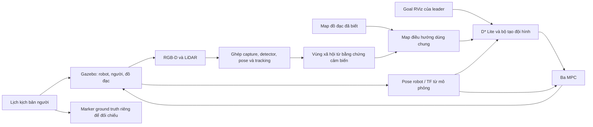
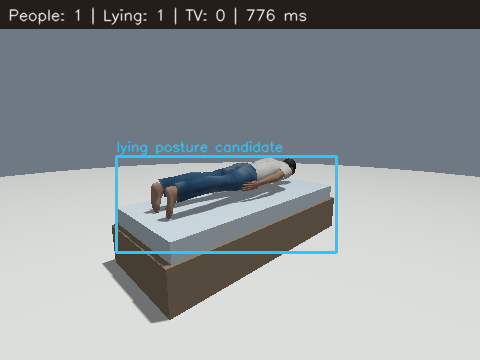
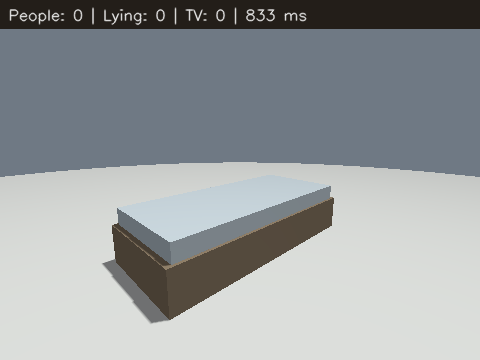

# Báo cáo tiến độ — Mô phỏng ba robot omni với D* Lite, MPC và vùng xã hội

**Ngày cập nhật:** 28/10/2026 — múi giờ Việt Nam.\
**Mốc chức năng hiện hành:** M6.\
**Giai đoạn:** đã có hệ thống demo tích hợp; đang hoàn thiện kiểm chứng và đánh giá.\
**Backend được chọn:** D* Lite + ba MPC, không chạy backend Paper1/Paper2.\
**Trạng thái vận hành cuối đã xác minh:** mô phỏng đã dừng theo yêu cầu người dùng.

**Đồng bộ GitHub:** bản nguồn đã được push thành công lên nhánh `main` của
`duc2605/three-robot-rescue`, commit nguồn `d1f6b96` (NK-019). Các thông báo
chưa đăng nhập/chưa push trong NK-018 bên dưới là trạng thái trước khi xử lý.

**Package hiện hành sau NK-017:** `social_navigation_planner` và
`social_navigation_sim`. Các tên package cũ ở phần lịch sử được giữ để
đối chiếu; lệnh hiện hành xem mục 14 và README chính. Bản nguồn đã dọn
build/install/log sau kiểm chứng để chuẩn bị GitHub, cần build lại trước khi chạy.

**Tên file hiện hành sau NK-016:** dùng `social_static`/`social_dynamic`
cho môi trường và tên thuật toán cho launch/module paper. Mục 13 liệt kê
tên và lệnh chạy mới; tên trong các mốc lịch sử trước đó là tên tại thời điểm đó.

**Cập nhật cấu trúc 28/10/2026:** đã tinh gọn theo yêu cầu, giữ D* Lite + MPC,
hai backend paper và hai môi trường `social_people`/`social_dynamic`.
Build và 115 test chức năng đã qua; chưa chạy lại Gazebo sau tinh gọn.
Chi tiết ở mục 12; mục 11 là kết quả rà soát trước khi xóa.

Thông tin sinh viên/nhóm, lớp và giảng viên hướng dẫn cần được điền trước khi
nộp bản chính thức. Tài liệu không tự đặt tên người, thời hạn hoặc tỷ lệ hoàn
thành khi chưa có tiêu chí nghiệm thu được thống nhất.

Lịch sử yêu cầu và chỉnh sửa: [Nhật ký dự án](README_NHAT_KY_DU_AN.md).

## 1. Mục tiêu và phạm vi

Xây dựng mô phỏng ROS 2/Gazebo cho ba robot omni di chuyển theo đội hình,
tìm đường tới đích và cập nhật tránh vật cản/vùng xã hội từ cảm biến. Các
tình huống nghiên cứu gồm nhóm trò chuyện, người xem TV, người nằm và người
di chuyển hoặc rời một hoạt động.

Phạm vi hiện tại là **điều hướng đội hình và nhận thức xã hội trong mô phỏng**.
Tên repository `three-robot-rescue` không đồng nghĩa đã hoàn thành hệ cứu hộ
tự chủ: chưa kiểm chứng robot thực, nhiệm vụ cứu nạn đầu cuối hoặc định vị
thực thay thế pose robot lấy từ Gazebo.

Hai phần cần phân biệt khi đánh giá:

- **Mô phỏng kịch bản:** tạo người/đồ đạc và lịch di chuyển để kiểm thử.
- **Nhận thức và điều hướng:** nhận dữ liệu RGB-D/LiDAR, suy luận vùng, lập
  đường và điều khiển; không lấy nhãn hoặc lịch người để giả làm nhận diện.

## 2. Kiến trúc hiện hành

| Khối | Thành phần chính | Vai trò |
|---|---|---|
| Mô phỏng | ROS 2 Humble, Gazebo Fortress, ba `3w_v2` | Robot, world, cảm biến và physics |
| Lập đường | `DStarLiteGrid` và coordinator | Tìm/cập nhật đường cho leader |
| Điều khiển | Ba `DistributedRobotMPC` | Bám tham chiếu chung, kiểm tra vật cản và teammate |
| Đội hình | Leader–follower, tam giác/hàng dọc | Thích nghi bề rộng và giữ khoảng cách theo vệt |
| Perception | YOLO-tiny, OpenPose MobileNet, tín hiệu hướng đầu/thân, RGB-D | Phát hiện và định vị các bằng chứng quan sát được |
| Theo dõi | `CameraPeople`, bộ nhớ xã hội và alias TV | Giữ bằng chứng ngắn hạn, hợp mảnh trùng, ước lượng vận tốc |
| Vùng xã hội | Nhóm trò chuyện, hành lang người–TV, vùng người/ứng viên nằm | Tạo lớp tránh chia sẻ với planner/MPC |
| Quan sát chủ động | `SocialSearch`, `ObservationSweep` | Yêu cầu quay có giới hạn, đi qua coordinator/MPC |
| Kịch bản động | `SocialScenarioMotion` | Điều khiển người bằng thời gian mô phỏng, không cấp nhãn cho perception |
| Quan sát kết quả | RViz và topic diagnostic | Xem robot, path, vùng cảm biến và marker kịch bản riêng |



Map vật lý chứa đồ đạc như giường/ghế/TV/bình nước, không chứa người hoặc
tuyến đi đã viết sẵn. Pose robot từ Gazebo vẫn là giả thiết mô phỏng; không
được dùng kết quả này để khẳng định hệ đã giải quyết định vị trên robot thực.
Điểm nhìn vật cản sát tuyến lấy từ hình học map/path chỉ là đề xuất quan sát,
không phải bằng chứng có người nằm.

## 3. Khác biệt giữa các mốc

Các mã M0–M6 là nhãn mô tả lịch sử, không phải Git tag hoặc release đã công bố.
Git HEAD được ghi nhận lúc lập hồ sơ là `5ac6982`; nhiều thay đổi sau đó chưa
được commit. Không dùng commit này để đại diện toàn bộ bản M6.

| Mốc | Khác biệt chính so với nền/mốc trước | Ý nghĩa và giới hạn |
|---|---|---|
| M0 — nền | D* Lite, ba MPC, đội hình, cảm biến và social pipeline có sẵn | Có demo; các README cũ mô tả nền và sửa đội hình/cảm biến |
| M1 — nhánh tham khảo | Paper1: GWO–WOA/DWA; Paper2: APF–MPC/enhanced APF | Là triển khai thích nghi, chưa xác nhận tái lập paper; không chứng minh tốt hơn nền |
| M2 — hình học TV | Từng quan hệ người–màn hình, đoạn màn hình đo từ RGB-D, hợp vùng nhìn riêng | Giảm phụ thuộc bề ngang giả định và bao lồi cả nhóm; cần đo chất lượng |
| M3 — TV trong runtime | Giữ lịch sử quan sát nối tiếp, hướng người ngồi, mặt trước TV, tách timeout thực/mô phỏng | Đã tạo được vùng trong Gazebo; audit sau vẫn phát hiện trùng ID |
| M4 — cảnh động riêng | Người nằm, rời TV–đi bình nước–quay lại, tuần tra; plugin có collision body | Kiểm tra được lịch/pose; chuyển động kinematic, chưa có animation đầy đủ |
| M5 — audit và thử qua giường | Đọc log/topic và theo dõi goal thực tế | Phân biệt tránh đồ đạc trên map với nhận diện người nằm |
| M6 — sửa pipeline | Ghép RGB-D trước DNN, hợp track/alias TV, cooldown chung, crop nằm và xác minh pose 3D, UDP riêng | Có hồi quy và đối chứng; chưa có benchmark đầy đủ hoặc xác nhận mọi góc nhìn |

**Quyết định lựa chọn thuật toán:** tiếp tục dùng D* Lite + MPC theo yêu cầu
người dùng. GCFF từng được đề xuất cho nhóm trò chuyện nhưng chưa triển khai.
Không gọi M6 là phiên bản GCFF hoặc Paper2 được nâng cấp.

## 4. Tiến độ theo hạng mục

| Hạng mục | Trạng thái | Phần còn cần hoàn thiện |
|---|---|---|
| Mô hình/khởi tạo ba robot | Đã tích hợp và chạy Gazebo | Độ ổn định trên nhiều máy/lượt khởi động |
| D* Lite + ba MPC | Đã hoạt động, có hồi quy | Benchmark thành công tới đích, thời gian và va chạm |
| Đội hình tam giác/hàng dọc | Đã tích hợp, có quan sát runtime | Sai số đội hình và chuyển dạng qua nhiều ca |
| RGB-D/LiDAR và TF | Đã tích hợp; ghép capture trước suy luận | Đo coverage, độ trễ và mất dữ liệu trên mẫu dài hơn |
| Vùng nhóm trò chuyện | Có quy tắc hiện hành | False positive/negative; GCFF chưa được triển khai |
| Vùng người–TV | Đã sửa hình học, thời gian và trùng track | Kiểm chứng nhiều người/TV, che khuất và thay đổi hoạt động |
| Người đi bộ/rời TV | Có kịch bản, tracking và xử lý thu hồi vùng | Thời gian thu hồi thực tế, ID switch và rủi ro ngoài góc nhìn |
| Người nằm | Có nhánh đề xuất + khớp RGB-D; đối chứng dương/âm bước đầu | Bộ dữ liệu nhiều góc/ánh sáng/tư thế và kiểm chứng tự quan sát trên tuyến |
| Kịch bản uống nước | Có tuyến đi và giai đoạn dừng tại bình nước | Animation và nhận diện hành vi uống chưa có |
| Khởi động DDS | Đã thêm UDP riêng; lượt sau có đủ node/cảm biến | Kiểm tra lặp restart và lựa chọn transport trên máy khác |
| Hiệu năng | Đã giảm tải cấu hình và đo bước đầu | RTF vẫn thấp, chưa có A/B kiểm soát |
| Báo cáo và lịch sử | Đã lập hai README, quy trình cập nhật và lưu minh chứng | Duy trì cùng từng thay đổi sau này |

**Đánh giá tiến độ tổng thể:** đã có nguyên mẫu tích hợp để demo và tiến hành
thực nghiệm. Chưa đủ căn cứ kết luận hoàn thành toàn bộ đề tài hoặc đạt mức
sẵn sàng vận hành thực. Không gán một phần trăm hoàn thành tùy ý.

## 5. Các sửa quan trọng của bản hiện hành

### 5.1. Cảm biến và theo dõi

- Chọn capture RGB-D còn mới, cùng frame và kích thước, lệch timestamp tối
  đa 0,06 s trước khi dùng CPU cho DNN. Giữ depth đã ghép trong suốt lượt xử lý.
- Không đếm lặp capture thành nhiều bằng chứng. Khung mới thiếu depth không
  làm bỏ qua cặp cũ vẫn hợp lệ. Mất dữ liệu vẫn có thể khiến pipeline chờ.
- Ghép vị trí người bằng dự báo ngắn có giới hạn, giữ ID qua mất dấu ngắn;
  loại/hợp các mảnh gần trùng và giữ timestamp gốc.
- Tâm TV từng phần được gắn với đoạn bề mặt đo được. ID nguồn được alias
  về cùng TV; các vùng gắn ID đã bỏ phải được thu hồi.

### 5.2. Vùng TV và chuyển hoạt động

- Mỗi người xem có một polygon nối tới màn hình; map hợp các polygon.
- Không bắt buộc hai người quay song song; dùng góc với bề mặt màn hình,
  hướng tin cậy, tầm nhìn và bằng chứng thời gian.
- Hướng đầu/thân không được gọi là hướng mắt đo được. Màn hình chỉ có tâm
  vẫn có bề ngang dự phòng 1,1 m, ghi rõ là ước lượng.
- Khi camera đo track đang di chuyển, thu hồi vùng xem cũ của track đó;
  giữ vùng của người còn ngồi. Mất quan sát không tương đương đã xác nhận rời đi.

### 5.3. Tư thế nằm và lượt quan sát

- YOLO-tiny vẫn có thể bỏ sót người nằm. Bổ sung đề xuất bề mặt thấp từ
  RGB-D, crop xoay và kiểm tra hình học khớp thân/hông/chân.
- Thiếu mũi có thể dùng hai vai tin cậy và chân xa phù hợp. Bề mặt thấp
  riêng lẻ không đủ để tạo nhãn người nằm; ứng viên cần nhiều capture để có vùng.
- Camera có thể nhìn có giới hạn vào vật cản sát tuyến; không đọc nhãn
  scenario để tự biết nơi có người ngủ.
- Cooldown áp dụng cho mọi kiểu tìm kiếm; lượt nhìn vật cản không bị tìm
  TV thay thế ngay. Bộ điều phối/MPC vẫn kiểm tra lệnh quay.

### 5.4. Profile động đang dùng

| Tham số | Giá trị mặc định |
|---|---|
| Camera | 480 × 360, 6 Hz theo thời gian mô phỏng |
| DNN | Tối đa 2 Hz thực, OpenCV 1 thread |
| Crop thân thường | Tối đa 2 crop, kích thước 224 px |
| Kiểm tra nằm | Mỗi 4 capture; crop nằm ngang 256 px |
| Ngân sách kết quả suy luận thực | 3 s, đồng thời vẫn kiểm tra độ mới capture |
| Lượt nhìn vật cản | Dwell 1,6 s mô phỏng, có giới hạn thời gian |
| ROS domain đã dùng | 31; đây là cấu hình vận hành, không phải tên phiên bản |
| DDS trong launch động | `dds_udp_only:=true`, có thể tắt để dùng môi trường mặc định |

Các giới hạn trên nhằm kiểm soát tải, không bảo đảm chạy thời gian thực trên
mọi phần cứng. Quy tắc/giới hạn suy luận chưa phải tham số đã tối ưu thống kê.

## 6. Kết quả kiểm chứng và mức bằng chứng

| Mã | Kiểm chứng đã thực hiện | Kết quả và phạm vi |
|---|---|---|
| KT-01 | Bộ test pipeline/mô phỏng Python | 55 passed tại lần kiểm tra chức năng gần nhất |
| KT-02 | Bộ test điều khiển được chọn | 50 passed, 1 skipped, 2 cảnh báo SciPy clipping; ba lint mẫu không chạy do thiếu gói ament tương ứng |
| KT-03 | Syntax/build | File thay đổi parse được; package mô phỏng đã build thành công |
| KT-04 | Lịch và pose người trong Gazebo headless | Qua đủ chu kỳ 112 s mô phỏng; các giai đoạn đi/dừng/quay lại được xác minh pose trong physics |
| KT-05 | Đối chứng camera nhìn giường có người | Pipeline xuất 1 ứng viên nằm từ khớp/chiều sâu |
| KT-06 | Đối chứng cùng giường bỏ người | Pipeline không xuất ứng viên nằm |
| KT-07 | Theo dõi goal qua khu vực giường trước tối ưu cuối | Ba robot đi vòng giường; chưa có `lying_person` trong mẫu đó |
| KT-08 | Audit topic trước/sau | Có các mẫu khoảng 22 s, cảm biến/pose và log; chưa là benchmark kiểm soát |
| KT-09 | Khởi động sau profile DDS mới | Đủ controller và camera hoạt động; đã khôi phục goal người dùng trong lượt chạy đó |
| KT-10 | Yêu cầu dừng mô phỏng | Cây tiến trình mô phỏng đã dừng; trạng thái cuối được giữ khi viết tài liệu |

Các số test là kết quả đã ghi nhận trước lúc lập hai README; không phải test
được chạy lại ngày 28/10/2026. Test số học hoặc kiểm thử hạn chế không thay
thế phép đo hành vi robot trên tập tình huống có lặp.

### 6.1. Hai mẫu hiệu năng đã ghi nhận

| Đại lượng | Mẫu trước | Mẫu sau |
|---|---:|---:|
| Cửa sổ thực | 22,01 s | 22,00 s |
| Thời gian mô phỏng trong cửa sổ clock | Khoảng 3,53 s | Khoảng 4,40 s |
| RTF | 0,160 | 0,200 |
| RGB nhận tại subscriber audit | 28 | 17 |
| Depth nhận tại subscriber audit | 20 | 22 |
| Timestamp RGB/depth trùng | 20 | 15 |

**Không diễn giải bảng này là tăng hiệu năng 25% do sửa thuật toán.** Trạng
thái chuyển động, cấu hình camera/transport và tình huống hai lượt khác
nhau; mẫu sau có robot chờ goal. Số frame nhận tại một subscriber cũng không
phải tỷ lệ mất gói toàn hệ. RTF khoảng 0,2 vẫn là chạy chậm hơn thời gian thực.

Trong hai ca camera đối chứng, thời gian suy luận lưu được khoảng 776 ms
(có người) và 833 ms (giường trống). Đây là hai mẫu, không phải p50/p95 hoặc
latency trung bình khi toàn bộ ba robot đang di chuyển.

### 6.2. Minh chứng tư thế nằm

Ảnh có người: mô hình tạo ứng viên tư thế nằm từ RGB-D và khớp người.



Đối chứng giường trống: không tạo ứng viên người nằm.



Hai mẫu không đủ tính precision/recall có ý nghĩa hoặc kết luận nhận diện mọi
góc nhìn. Nhãn đúng ở đây là **ứng viên tư thế nằm**, không phải xác nhận ngủ.

### 6.3. Ý nghĩa của ca đi qua giường

Khoảng hở tới mép giường ước tính nhỏ nhất trong mẫu là 0,061/0,062/0,054 m
cho robot1/2/3, dùng bán kính cấu hình 0,15 m. Không có đo contact đầy đủ hoặc
đo khoảng cách chính xác tới thân người trong ca này. Giường có sẵn trên map
và camera lấy mẫu không nhìn thấy người nằm.

Vì vậy, ca này chứng minh được robot đã đi vòng vật cản map ở mức quan sát,
**chưa chứng minh** giữ khoảng cách xã hội nhờ nhận diện người nằm. Mẫu cuối
leader còn cách goal khoảng 3,19 m, nên không tính đó là ca tới goal thành công.

## 7. Hạn chế và việc còn mở

1. Chưa có tập test nhiều góc nhìn, che khuất, ánh sáng, số người/TV hoặc các
   lượt chuyển hoạt động đủ để đánh giá precision/recall, IoU và ID switch.
2. Nhánh hợp track/cooldown đã có hồi quy và tích hợp nhưng cần thử dài để
   xác nhận giảm đếm trùng, vùng tồn dư và thời gian dừng trong thực tế mô phỏng.
3. Nhận diện người nằm mới có đối chứng bước đầu; chưa chứng minh robot tự
   quan sát và bảo vệ đúng vùng người nằm trên mọi tuyến đi.
4. RTF còn thấp; cần profile CPU/GPU, rendering, sensor transport, DNN và
   planner/MPC thay vì gán toàn bộ nguyên nhân cho một node.
5. RViz vẫn ghi lỗi shader indexed map lúc mở; chưa xác nhận xử lý dứt điểm.
6. Người trong world động đi theo lịch và chuyển tư thế theo giai đoạn;
   chưa có animation đầy đủ hoặc hành vi tương tác/nhường robot.
7. Định vị robot đang dùng pose từ mô phỏng. Dữ liệu kịch bản không dùng để
   nhận diện người, nhưng giả thiết định vị robot này vẫn cần nêu khi báo cáo.
8. Chưa có benchmark công bằng giữa các backend hoặc giữa các cấu hình.
   Cảnh `people` và `dynamic` khác đồ đạc, nên không so trực tiếp rồi quy
   toàn bộ khác biệt kết quả cho thuật toán.

## 8. Kế hoạch để hoàn thành phần đánh giá

Các việc dưới đây là kế hoạch đề xuất, chưa phải kết quả đã đạt hoặc thời hạn
đã cam kết với giảng viên.

| Ưu tiên | Công việc | Điều kiện nghiệm thu đề xuất |
|---|---|---|
| P1 | Kiểm tra lại route cạnh người nằm sau sửa | Có capture cho thấy người, vùng cảm biến và path thay đổi tương ứng; đo contact và khoảng cách, không chỉ tránh giường |
| P1 | Đánh giá chuyển người rời TV | Phân biệt người rời đi/người còn ngồi; đo ID switch, số vùng trùng và độ trễ thu hồi |
| P1 | Benchmark chạy nhiều lần | Giữ cùng world, start/goal, lịch/tốc độ người, sensor và máy; ghi cả ca thất bại |
| P2 | Profile hiệu năng | p50/p95 latency, RTF, CPU/GPU và rate topic trong cùng điều kiện trước/sau |
| P2 | Bộ dữ liệu perception | Nhiều góc/tư thế/che khuất; nhãn kiểm thử riêng; precision/recall, IoU và sai số vị trí |
| P2 | Ổn định khởi động/đồ họa | Lặp startup/shutdown; kiểm tra DDS và lỗi RViz trên cấu hình phần cứng ghi rõ |
| P3 | Hoàn thiện thể hiện người động | Animation bước chân/ngồi–đứng/uống nếu nằm trong yêu cầu đề tài |
| P3 | Hoàn thiện báo cáo cuối | Chốt tiêu chí với giảng viên, lưu log/ảnh/CSV, phân tích số liệu và giới hạn |

Bộ chỉ số nên gồm tỷ lệ tới goal, thời gian thực/mô phỏng, chiều dài đường,
sai số đội hình, khoảng cách tối thiểu tới người/vật cản, contact, thời gian
dừng quan sát, số vùng trùng/tồn dư và độ trễ nhận thức. Có thể bắt đầu với
10 lần lặp mỗi ca; đây là đề xuất thiết kế thử nghiệm, chưa thực hiện.

## 9. Tái chạy và truy xuất minh chứng

Tại thư mục gốc workspace, sau khi đã dừng phiên cũ:

```bash
source /opt/ros/humble/setup.bash
CMAKE_BUILD_PARALLEL_LEVEL=2 colcon build \
  --base-paths social_navigation_planner social_navigation_sim \
  --packages-select social_navigation_planner social_navigation_sim \
  --symlink-install --executor sequential
source install/setup.bash
export ROS_DOMAIN_ID=31
export QT_QPA_PLATFORM=xcb
ros2 launch social_navigation_sim social_dynamic.launch.py
```

`motion_enabled:=false` chỉ dừng robot, không dừng lịch người khi đồng hồ
Gazebo vẫn chạy. Không khởi động các nhánh Paper chỉ vì còn file source.

Đối chiếu cảnh tĩnh:

```bash
ros2 launch social_navigation_sim social_navigation.launch.py \
  navigation_backend:=baseline social_scene:=static
```

Lệnh kiểm tra pipeline và bộ điều khiển đã dùng:

```bash
source /opt/ros/humble/setup.bash
PYTHONDONTWRITEBYTECODE=1 python3 -m pytest \
  social_navigation_sim/test -q -p no:cacheprovider

PYTHONPATH=social_navigation_planner PYTHONDONTWRITEBYTECODE=1 python3 -m pytest \
  social_navigation_planner/test \
  --ignore=social_navigation_planner/test/test_copyright.py \
  --ignore=social_navigation_planner/test/test_flake8.py \
  --ignore=social_navigation_planner/test/test_pep257.py \
  -q -p no:cacheprovider
```

Minh chứng cố định trong repo:

- [Kết quả hai ca camera](docs/evidence/2026-10-27/posture_validation.json).
- [Runtime trước](docs/evidence/2026-10-27/runtime_before.json) và
  [runtime sau](docs/evidence/2026-10-27/runtime_after.json).
- [Trích log kiểm tra lịch/pose người](docs/evidence/2026-10-27/scenario_motion_validation.log).
- [Hướng dẫn cảnh động](social_navigation_sim/README_SOCIAL_DYNAMIC.md),
  [hướng dẫn đội hình](social_navigation_sim/README_DSTAR_MPC.md).

Các file là bản lưu kết quả của phiên trước, không phải dữ liệu benchmark
mới của ngày lập README. Muốn xác nhận trên máy khác cần chạy lại và ghi
điều kiện tương ứng; không chỉ sao chép các con số này vào kết quả thực nghiệm mới.

## 10. Lịch sử và quy trình cập nhật báo cáo

| Ngày | Thay đổi hồ sơ | Mốc chức năng | Kiểm tra trong lần cập nhật tài liệu |
|---|---|---|---|
| 28/10/2026 | Lập báo cáo, tổng hợp trao đổi, bảng tiến độ/phiên bản, lưu minh chứng và thêm quy trình cập nhật | M6, không thay thuật toán | Kiểm tra liên kết, JSON/ảnh minh chứng và nhất quán nội dung; không chạy lại mô phỏng |
| 28/10/2026 | Rà soát thành phần ngoài chuỗi launch động, entry point tồn dư và tham số legacy; nhật ký NK-014 | M6, không đổi code hoặc xóa file | Đọc launch/import/CMake/setup và tìm tham chiếu; không kiểm thử gỡ thành phần hoặc khởi động ROS |
| 28/10/2026 | Tinh gọn còn hai package, ba backend và hai scene; nhật ký NK-015 | M6, giữ thuật toán; thay cấu trúc và mặc định launch nền | Build sạch; 115 test qua; 12 output generator giống từng byte; kiểm tra launch, tài nguyên và Xacro; chưa chạy Gazebo |
| 28/10/2026 | Chuẩn hóa 31 tên file, thêm launch tĩnh, đồng bộ import/asset/tài liệu; nhật ký NK-016 | M6, giữ thuật toán; tên world tĩnh/giá trị scene đổi sang static | Build sạch; 115 test qua; kiểm tra bảy launch, sáu tổ hợp scene/backend và generator tương đương sau chuẩn hóa tên; chưa chạy Gazebo |
| 28/10/2026 | Đổi cả hai package, loại cấu hình cá nhân/output và thêm đóng gói nguồn GitHub; nhật ký NK-017 | M6, không thay thuật toán | Build sạch tên package mới; 115 test qua; kiểm tra launch/import/Xacro/tài nguyên, kích thước và một số mẫu credential; chưa chạy Gazebo, chưa push |
| 28/10/2026 | Đồng bộ bản nguồn đã làm sạch tới `duc2605/three-robot-rescue`, nhánh `main`; nhật ký NK-018 | M6, không thay thuật toán | Đối chiếu remote, kiểm tra bộ nguồn/diff; dùng lại minh chứng NK-017, không chạy lại mô phỏng |
| 28/10/2026 | Đăng nhập `duc2605` và push nguồn thành công; nhật ký NK-019 | M6, không thay thuật toán | Git xác nhận `main` từ `115f150` sang `d1f6b96`, không force-push; không chạy lại test/Gazebo |

Mỗi lần thay đổi dự án, cập nhật đồng thời nhật ký và báo cáo theo
[AGENTS.md](AGENTS.md): ghi điều gì thay đổi, kiểm chứng mới, hạn chế còn lại
và ảnh hưởng tới tiến độ. Không xóa kết quả cũ; nếu kết luận thay đổi, thêm
đính chính. Việc duy trì do các tác vụ/người sửa trong repo thực hiện, không
phải một dịch vụ nền tự sinh nội dung báo cáo.

## 11. Kết quả rà soát trước tinh gọn — NK-014

Mục này giữ kết luận tại thời điểm rà soát. Quyết định và trạng thái sau
khi xóa theo yêu cầu tiếp theo nằm ở mục 12, thay cho đề xuất giữ/gỡ bên dưới.

Phạm vi rà soát ngày 28/10/2026 là chuỗi `dynamic_social.launch.py` →
`three_robot_social.launch.py` → `three_robot_dstar_mpc.launch.py` →
`three_robot_gazebo.launch.py`, chọn backend `baseline` và scene `dynamic`.
Đây là kết quả đọc mã tĩnh, chưa phải thử nghiệm loại bỏ module.

| Nhóm | Thành phần | Kết luận và hướng xử lý |
|---|---|---|
| Backend tham khảo | `paper1_social.launch.py`, `paper2_social.launch.py`, `paper1_node/core.py`, `paper2_node/core.py` và test tương ứng | Không chạy trong baseline; có thể lưu nhánh riêng nếu bỏ nhu cầu so sánh |
| Điều khiển cũ | Package `multi_robot_formation`, `virtual_structure_3robot`; script `scripts/a_star_planner.py` | Không được chuỗi hiện tại gọi; tách khỏi bản demo sau khi kiểm tra phụ thuộc đầy đủ |
| Khai báo tồn dư | `astar_node`, `pid_follower` trong `astar_planner/setup.py` | Hai module nguồn không tồn tại; nên gỡ khai báo nếu không khôi phục tính năng cũ |
| Demo mẫu | `src/test_publisher.cpp`/`test_cpp_publisher`, `scripts/test_subscriber.py`, `scripts/test_run_motor.py` | Không được launch hiện tại gọi; có thể tách khỏi bản demo; khác với regression test cần giữ |
| Chế độ khác | `gazebo_sim.launch.py`, `navigation_gazebo_sim.launch.py`, `nav2.launch.py`, `slam_gazebo_sim.launch.py`; model `3w`, `3w_v2`, `4w`, `5w`, `6w` | Ngoài chế độ ba robot dùng `3w_v2_multi`; vẫn phục vụ demo một robot và Nav2/SLAM riêng |
| Tham số cũ | `social_protect_uncertain`, `social_inferred_focus`, `social_provisional_memory` | Hai tùy chọn đầu chỉ còn cảnh báo legacy; không tìm thấy xử lý dùng `provisional_memory` ngoài khai báo/truyền tham số |
| Dữ liệu sinh ra | `build/`, `install/`, `log/`, `__pycache__/` | Không phải mã nguồn; `install/` đang phục vụ chạy ROS, `build/install` chỉ dọn khi có kế hoạch build lại |
| Bản sao lưu | `patch_backups/`, `.codex_backups/` | Không thuộc runtime; xem lại giá trị khôi phục trước khi dọn |

**Cần giữ:** các scene tĩnh `people`/`rooms` để đối chiếu theo yêu cầu người
dùng; `_graphics_backend.py` được hai launch nền nạp; `kinematics.cpp` chạy
cho robot; helper đội hình được import gián tiếp; model detector/head/body
pose đang phục vụ perception. Generator world/model là công cụ tạo lại
tài nguyên, dù không chạy mỗi lần launch. `nav2_map_server` và
`nav2_lifecycle_manager` vẫn được dùng bởi baseline, dù full Nav2 không chạy.

Không xóa file hoặc sửa thuật toán trong lần rà soát này. Nếu tinh gọn sau
này, phải kiểm tra cả cấu hình tĩnh đối chiếu, test, build/install và khả năng
tái tạo tài nguyên; việc tinh gọn chưa được tính là đã hoàn thành.

## 12. Kết quả tinh gọn ngày 28/10/2026 — NK-015

**Đã hoàn thành tinh gọn cấu trúc**, giữ mốc thuật toán M6. Repository còn
hai package nguồn `astar_planner` và `ros2_omni_robot_sim`.

| Thành phần giữ lại | Trạng thái |
|---|---|
| D* Lite + ba MPC, đội hình và tránh vùng xã hội | Giữ nguyên thuật toán; backend mặc định |
| Paper1 GWO–WOA/DWA và Paper2 APF–MPC | Giữ code, entry point, launch, tài liệu và test |
| `social_people` tĩnh | Giữ world/map/manifest/bridge và generator |
| `social_dynamic` động | Giữ world/map/manifest/bridge, plugin và generator |
| Cảm biến/perception/TV/người nằm/quan sát chủ động | Giữ pipeline hiện hành, model và trọng số |
| Robot `3w_v2_multi` và mesh `3w_v2` | Giữ tài nguyên được tham chiếu; chuyển roller về URDF hiện hành |
| Test hồi quy và minh chứng | Giữ; map mê cung cũ chỉ còn trong fixture test |

**Đã gỡ:** hai package A*/PID/virtual structure cũ, demo A* và pub/sub/motor,
launch một robot/Nav2/SLAM, URDF/mesh mẫu robot không dùng, GIF, installer
Jazzy/Harmonic, môi trường mê cung/phòng cũ và cấu hình đi kèm. Bỏ lựa chọn
`rooms`; launch nền mặc định sang `social_people`. Paper dùng động bằng
`social_scene:=dynamic`. `nav2_map_server`/`nav2_lifecycle_manager` vẫn giữ.

Hai generator đang dùng phụ thuộc hình học từ file generator cũ, nên tách
nguyên phần dùng chung thành `scene_geometry.py`/`map_geometry.py` trước
khi xóa. Một include roller gián tiếp cũng được chuyển trước khi xóa URDF
cũ; điều này đính chính đánh giá URDF `3w_v2` trong NK-014. Không xóa model
người/trọng số perception hoặc helper đội hình chỉ vì không có node riêng.

Output build/install/log và backup cũ đã dọn; hai package hiện hành đã build
lại. `.gitignore` loại output/cache/backup mới. Snapshot cũ có file generated
được Git theo dõi, nên `.gitignore` không tự gỡ chúng khỏi Git index.
Danh sách đường dẫn chi tiết nằm trong [manifest](docs/cleanup_2026-10-28.json).

| Kiểm chứng mới | Kết quả và giới hạn |
|---|---|
| Build sạch | Hai package thành công; `BUILD_TESTING=OFF` vì thiếu ament lint, regression chạy riêng |
| Hồi quy chức năng | **115 passed**, hai warning SciPy clipping bounds trong Paper2; bỏ ba file lint |
| Fixture/mock test | Giữ nguyên ảnh map lịch sử trong `test/fixtures`; bổ sung hai thuộc tính tốc độ production còn thiếu trong mock coordinator |
| Generator trước/sau | **12 file giống từng byte**, tạo trong thư mục tạm; không ghi đè world/map hiện tại |
| Launch | Bốn launch chính đọc được `--show-args`; sáu tổ hợp scene/backend resolve đúng asset |
| Robot/tài nguyên | Xacro leader/follower hợp lệ; 31 tham chiếu URDF/world hợp lệ |
| Gazebo/goal | **Chưa chạy lại sau tinh gọn**; giữ yêu cầu dừng mô phỏng |

Minh chứng mới: [log test](docs/evidence/2026-10-28/cleanup_tests.log) và
[biên bản kiểm tra](docs/evidence/2026-10-28/cleanup_validation.json).
Build/test/cấu hình thành công chưa chứng minh mọi ca runtime hoặc chất
lượng nhận diện đã đạt yêu cầu. Các hạn chế thuật toán/benchmark ở mục trước
vẫn áp dụng. Bản khôi phục trước dọn được lưu tạm ở
`/tmp/three-robot-rescue-before-cleanup-20261028.tar.gz`.

## 13. Tên file và lệnh chạy sau chuẩn hóa — NK-016

Đã đổi 31 file và thêm một launch tĩnh. Hai package ROS vẫn là
`astar_planner` và `ros2_omni_robot_sim`; thuật toán và topic điều khiển giữ
nguyên. Môi trường tĩnh đổi tên world từ `social_people` sang `social_static`,
đồng bộ bridge và manifest; tham số `social_scene` nhận `static`/`dynamic`.

| Vai trò | Tên cũ | Tên mới |
|---|---|---|
| Tĩnh | Gọi qua launch chung | `social_static.launch.py` |
| Động | `dynamic_social.launch.py` | `social_dynamic.launch.py` |
| Launch chung | `three_robot_social.launch.py` | `social_navigation.launch.py` |
| Backend nền | `three_robot_dstar_mpc.launch.py` | `dstar_mpc.launch.py` |
| Gazebo/robot | `three_robot_gazebo.launch.py` | `three_robot_sim.launch.py` |
| Paper1 | `paper1_social.launch.py` | `paper1_gwo_woa.launch.py` |
| Paper2 | `paper2_social.launch.py` | `paper2_apf_mpc.launch.py` |
| Module D*/MPC | `three_robot_dstar_mpc.py` | `dstar_mpc_controller.py` |
| Map xã hội | `scripts/social_navigation.py` | `scripts/social_costmap.py` |
| Tài nguyên tĩnh | Các file `social_people.*` | `social_static.*` và generator tương ứng |
| Hai bridge | `gz_bridge_social_people/dynamic.yaml` | `social_static_bridge.yaml`, `social_dynamic_bridge.yaml` |
| Kinematics/config robot | `kinematics.cpp`, `controller_config_3w_v2_3robots.yaml` | `omni_kinematics.cpp`, `three_robot_controllers.yaml` |

Module và test paper có thêm `gwo_woa`/`apf_mpc`; README được đổi theo
chủ đề. [Manifest đầy đủ](docs/rename_2026-10-28.json) ghi ánh xạ từng file.
Không tạo bản trùng mang tên cũ; khi chạy cần dùng lệnh mới sau khi source
`install/setup.bash` của bản build lại.

```bash
# D* Lite + MPC: chọn một môi trường
ros2 launch ros2_omni_robot_sim social_static.launch.py
ros2 launch ros2_omni_robot_sim social_dynamic.launch.py

# Paper1 / Paper2: mặc định tĩnh; thêm social_scene:=dynamic để thử cảnh động
ros2 launch ros2_omni_robot_sim paper1_gwo_woa.launch.py
ros2 launch ros2_omni_robot_sim paper2_apf_mpc.launch.py
```

**Kết quả:** build sạch hai package; 115 test chức năng qua với hai warning
SciPy, ba lint file không chạy; cả bảy launch đọc được tham số; sáu tổ hợp
scene/backend trỏ đúng asset; Xacro leader/follower và import module hợp lệ.
Generator tạo 12 file tương đương trước/sau sau khi chuẩn hóa tên world/path;
31 tham chiếu tài nguyên hợp lệ. Bản cài đã gỡ tên asset cũ. Chưa chạy lại
Gazebo/goal, nên đây là kiểm chứng build/test/cấu hình sau đổi tên.

Minh chứng: [test](docs/evidence/2026-10-28/rename_tests.log),
[build](docs/evidence/2026-10-28/rename_build.log),
[đối chiếu generator](docs/evidence/2026-10-28/rename_checks.log).

## 14. Bản nguồn chuẩn bị GitHub — NK-017

| Tên trước | Tên package hiện hành | Vai trò |
|---|---|---|
| `astar_planner` | `social_navigation_planner` | D* Lite + ba MPC, đội hình và hai backend paper |
| `ros2_omni_robot_sim` | `social_navigation_sim` | Robot, perception, vùng xã hội và hai môi trường Gazebo |

Đã đồng bộ namespace Python, marker ament, manifest, setup/CMake, import,
package URI/Xacro, launch và tài liệu. Console executable và topic điều
khiển giữ nguyên. Điều này thay quyết định giữ tên package ở NK-016;
không thay thuật toán hoặc kết quả benchmark đã báo cáo.

Đã loại cấu hình VS Code máy cũ, dọn output/cache và bổ sung ignore cho
editor/agent/tài khoản/credential. `.agents`, `.codex`, `.aws` là thư mục
chỉ đọc do môi trường quản lý, không đưa vào bản nguồn đóng gói. Không sửa
Git remote/history và chưa commit/push. Xem [chuẩn bị GitHub](docs/GITHUB_PREPARATION.md)
để ghi nhận cả deletion của build/install/log từng được snapshot cũ theo dõi.

```bash
source /opt/ros/humble/setup.bash
colcon build --symlink-install \
  --base-paths social_navigation_planner social_navigation_sim \
  --packages-select social_navigation_planner social_navigation_sim \
  --cmake-args -DBUILD_TESTING=OFF
source install/setup.bash
export ROS_DOMAIN_ID=31
ros2 launch social_navigation_sim social_dynamic.launch.py
```

Chọn `social_static.launch.py`, `paper1_gwo_woa.launch.py` hoặc
`paper2_apf_mpc.launch.py` cho các chế độ còn lại. Bản nguồn cuối không giữ
build/install/log; phải build lại khi muốn chạy mô phỏng.

**Kiểm chứng sau đổi package:** build sạch hai package thành công; 115 test
qua, hai warning SciPy; ba file lint không chạy. Bảy launch đọc được tham
số; sáu tổ hợp scene/backend resolve asset; import ba backend trong namespace
mới và Xacro leader/follower hợp lệ; 31 tham chiếu tài nguyên hợp lệ.
Chưa chạy lại Gazebo/goal. Minh chứng:
[build](docs/evidence/2026-10-28/github_build.log),
[test](docs/evidence/2026-10-28/github_tests.log).

`scripts/prepare_github.py` tạo ZIP chỉ chứa nguồn/tài nguyên/tài liệu,
kiểm tra file dưới 100 MiB và một số mẫu credential, không phải kiểm toán
bí mật đầy đủ. ZIP `/tmp/three-robot-rescue-github.zip` có thể tái tạo.
Giấy phép/attribution giữ theo từng thành phần; planner chưa có giấy phép
được chủ sở hữu xác định, chi tiết tại [LICENSES.md](LICENSES.md).

## 15. Đích đồng bộ GitHub — NK-018

Repository được người dùng chỉ định là
[duc2605/three-robot-rescue](https://github.com/duc2605/three-robot-rescue),
nhánh `main`. Commit nền remote tại thời điểm chuẩn bị cập nhật là
`115f150c4fd6c8660ec798838c5638e452ec5e93`.

Bản cập nhật gồm cây nguồn đã làm sạch ở NK-017 và hồ sơ hiện hành. Dùng
commit mới nối tiếp lịch sử remote, không force-push; không nhập lịch sử
snapshot build/install/log của workspace cũ. Kiểm tra danh sách staged file
và đối chiếu HEAD remote sau push; mã commit/link kết quả được báo khi Git
đã xác nhận. Kết quả build/115 test trong báo cáo là minh chứng của NK-017,
không phải kiểm thử mới hoặc benchmark mới trong lần đồng bộ này.

**Trạng thái thực tế:** commit đã chuẩn bị trong clone tạm, **chưa push
thành công**. HTTPS chưa có thông tin đăng nhập, SSH agent không có khóa;
plugin GitHub chưa được kết nối. Cần đăng nhập/kết nối GitHub để tiếp tục;
không coi nhánh remote đã được cập nhật.

**Cập nhật NK-019:** lỗi xác thực trên đã được xử lý. Push thành công đưa
`main` từ `115f150` sang
[commit nguồn `d1f6b96`](https://github.com/duc2605/three-robot-rescue/commit/d1f6b96).
Hai README được cập nhật tiếp để ghi nhận kết quả. Không có thay đổi thuật
toán, benchmark hoặc lượt chạy mô phỏng mới trong thao tác đồng bộ này.
