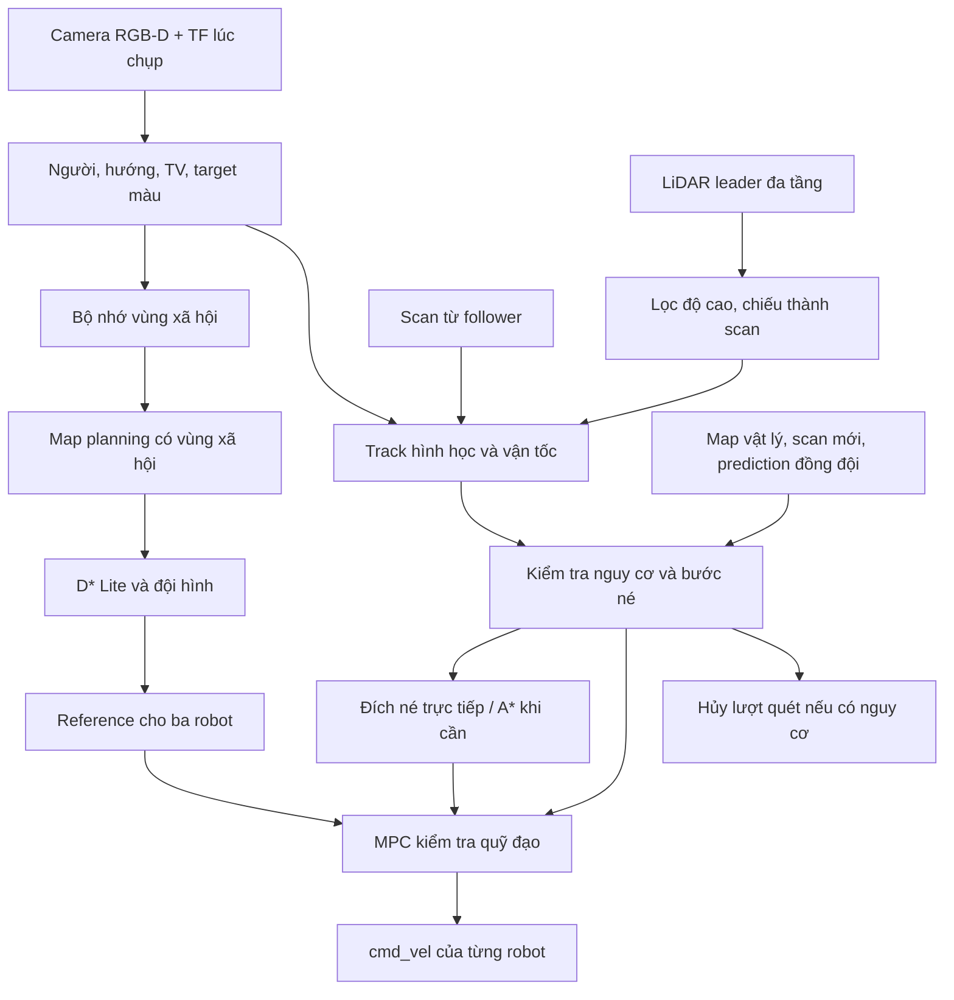

# Leader: camera, LiDAR và điều khiển phối hợp như thế nào

Cập nhật 28/10/2026, tương ứng NK-039. Đây là mô tả source đã sửa;
process mô phỏng cũ không tự nạp thay đổi. Chưa replay Gazebo ca tiếp xúc
sau bản sửa này. Camera và LiDAR không trực tiếp phát vận tốc cho robot.

## 1. Dữ liệu camera đi đâu

`leader_person_detector.py` chọn cặp RGB và depth phù hợp, kiểm tra tuổi
frame, chạy detector trong worker và định vị kết quả bằng TF tại thời
điểm chụp. Frame cũ/kết quả quá trễ không được coi là quan sát mới.

Kết quả đi theo hai nhánh:

- Pose người trong map đi vào MotionTracks của mỗi MPC để ước lượng vận
  tốc và nguy cơ. Ước lượng vận tốc cần ba capture nhất quán trong ít nhất
  0,2 s, có giới hạn sai số và vận tốc; không đọc lịch người của kịch bản.
- Hướng người, TV/đoạn màn hình, target màu đi vào `social_costmap.py` và
  `color_attention.py`. Vùng viewing đã xác nhận được nhớ trong phiên khi
  camera nhìn đi nơi khác; vùng nhớ được đánh dấu cần kiểm tra lại, không
  được coi là hoạt động mới quan sát. Phép đo người rời/đổi hướng thu hồi
  vùng tương ứng. Nhận diện TV và target màu heuristic vẫn là hai loại khác.

Camera sweep là yêu cầu quan sát qua coordinator, tạo reference giữ vị
trí/quay. Detector không sở hữu `/robot3/cmd_vel`. Khi MPC báo nguy cơ,
coordinator hủy sweep để nhánh né có ưu tiên.

## 2. Dữ liệu LiDAR đi đâu

Leader có LiDAR đa tầng ở trên cột camera. `leader_obstacle_scan.py` dùng
TF tại timestamp cloud để đổi về base_link, bỏ điểm sàn/tự thân và giữ
độ cao 0,025–0,40 m trên base_link. Scan xuất ra có 240 hướng; không tạo
scan tự do giả khi cloud hoặc TF bị lỗi. Follower dùng scan phẳng riêng.

Mỗi MPC nhận scan riêng và scan của hai robot còn lại. Scan được đổi sang
map theo pose robot đang đo, lọc bề mặt tĩnh đã có trên map vật lý và
teammate, rồi gom cụm để theo dõi vị trí/vận tốc. Giữ cả cụm một tia;
một tia chưa xác nhận không đủ cho nhánh phục hồi mới.

Scan của teammate hỗ trợ lúc leader bị che, nhưng không thay scan riêng
trong điều kiện cho phép chuyển động. Điểm LiDAR thô chưa thuộc track
chuyển động vẫn được kiểm tra riêng để không bỏ vật cản chưa phân loại.

## 3. Thuật toán di chuyển quyết định thế nào

1. D* Lite lập tuyến tới goal người dùng trên map planning gồm vùng xã hội.
2. Coordinator tạo reference đội hình: leader đi trước, follower bám;
   đội hình tam giác/hàng dọc và khoảng cách thay đổi theo lối đi.
3. Mỗi robot có một MPC riêng, xét các vận tốc ngang/dọc/quay, giới hạn
   gia tốc, vật cản, quỹ đạo đồng đội và sai số bám reference.
4. Nguy cơ tiếp xúc kích hoạt nhánh né dù thiếu reference hoặc đang quét.
   A* không gian–thời gian đề xuất đích tạm sau/trái/phải; MPC kiểm tra lại
   rollout trước khi phát command. Goal chính không đổi.
5. Trạng thái/scan thiếu mới hoặc không có quỹ đạo được kiểm tra hợp lệ
   dẫn tới dừng. Dừng không xóa cờ nguy cơ. Hết nguy cơ, coordinator lập
   lại đường từ pose đo được tới goal cũ.

Nhánh né có thể tạm vượt vùng xã hội để thoát nguy cơ, nhưng vẫn kiểm tra
map vật lý, LiDAR thô, người và teammate. Chuyển động bình thường vẫn dùng
đầy đủ vùng đệm. Đây là các kiểm tra theo mô hình đo, không bảo đảm cảm
biến định vị đúng tuyệt đối.

## 4. Lỗi leader đứng yên và bản sửa lần này

Trước sửa, một track được biểu diễn bằng một bán kính đã gộp cả kích
thước và dự phòng. Khi vòng tròn đó phủ điểm đứng, swept clearance của
mọi đoạn chứa điểm bắt đầu đều thấp hơn 0,03 m. Tìm thêm đích A* không
giải quyết được điều kiện loại ngay bước đầu, kể cả khi thân ước lượng
chưa tiếp xúc.

Bản mới tách hai đại lượng:

- **Body envelope:** kích thước ước lượng từ model người/extent cụm đo.
  Camera dùng bán kính model 0,32 m; LiDAR giữ extent đo được với sàn
  0,32 m. Đây là giả định kỹ thuật, không phải kích thước thật đã xác minh.
- **Vùng dự phòng:** phần hình dạng chưa thấy ở LiDAR và dự phòng do tuổi
  phép đo. Track camera/LiDAR vẫn giữ vòng đầy đủ cho điều hướng thường.

Chỉ khi đã nằm trong vùng dự phòng, track được xác nhận và phần thân vẫn
còn khoảng hở, bước né mới được xét theo các điều kiện đồng thời:

1. Cả đoạn chuyển động cách thân ước lượng ít nhất 0,03 m, kể cả khi người
   đang đi; không chỉ kiểm tra hai điểm đầu/cuối.
2. Khoảng hở với vòng dự phòng không giảm trên đoạn và tăng tại cuối bước.
3. Đích cuối rollout phục hồi và khoảng giữ ngắn phải ra ngoài toàn bộ
   vùng dự phòng. Không chỉ lùi một chút rồi tiếp tục nằm trong vùng đó.
4. Map vật lý, scan riêng còn mới, điểm LiDAR thô và khoảng cách teammate
   vẫn phải hợp lệ. Không phục hồi bằng cách xuyên vật cản/thân ước lượng.

Nếu bắt đầu đã chạm thân ước lượng hoặc không còn lối, xe vẫn dừng.
`safety_status` nay báo body gap/buffer gap khi không có escape; nhánh MPC
bình thường báo số proposal bị loại do map, LiDAR, track, peer. Các số
đếm là chẩn đoán proposal, không phải benchmark số lần tránh va chạm.

## 5. Ba phần có thể chặn lẫn nhau ở đâu

| Chỗ tương tác | Điều có thể xảy ra | Cách xử lý hiện có / giới hạn |
|---|---|---|
| Camera cần quay, người đang tiến tới | Reference giữ XY cản việc né | Nguy cơ an toàn hủy sweep; MPC né không phụ thuộc reference |
| Cùng người có camera và nhiều LiDAR track | Nhiều vòng dự phòng cùng chặn một quỹ đạo | Đã tách body/dự phòng; vẫn kiểm tra mọi track, chưa fusion thành một identity chung |
| Map xã hội với lối thoát khẩn | Vùng xã hội phủ lối né | Hai map riêng; override khẩn có kiểm tra map vật lý |
| Người ngoài tầm camera | Vùng bị mất hoặc giữ sai hoạt động cũ | Bộ nhớ viewing cần recheck; chưa tự chứng minh người đã rời khi không thấy |
| Camera/DNN, Gazebo và MPC cùng dùng CPU | Frame/scan/reference trễ, watchdog dừng | Worker detector, giới hạn thread/rate và TTL hiện có; chưa có bảo đảm deadline |
| Một robot né vào lối robot khác | Va nhau trong đội hình | Trao đổi prediction, kiểm tra swept separation; có thể vẫn không còn lối hợp lệ |

Các xung đột trên là logic/ràng buộc và tài nguyên xử lý. Bản hiện tại
chưa có một bộ fusion identity chung cho mọi camera/LiDAR.

## 6. Tối ưu tiếp cả ba theo thứ tự nào

**Đã có trong source:** một MPC phát command cho mỗi robot ở backend
baseline; ưu tiên an toàn hơn quét camera và reference đội hình; timestamp
capture/TF, watchdog; tách map; bộ nhớ viewing; nhánh thoát dự phòng mới.

**Cần đo/triển khai tiếp, chưa được coi là hoàn thành:**

1. Ghi đồng bộ tuổi RGB-D/scan/state/reference, thời gian xử lý MPC và lý
   do dừng. Dùng dữ liệu này để chọn ngân sách xử lý trước khi tăng rate.
2. Ghép camera–LiDAR theo vị trí, timestamp và độ tin cậy đã kiểm chứng;
   giữ provenance. Không xóa track chỉ vì hai tâm gần nhau hoặc bỏ điểm
   LiDAR thô để tạo đường trống giả.
3. Đo/calibrate body radius và uncertainty theo sai số thực, khoảng cách,
   mức che khuất; các số cố định hiện tại chưa được hiệu chuẩn thống kê.
4. Dùng trạng thái rõ cho bám đường, quan sát, nhường/phục hồi, dữ liệu cũ;
   kiểm tra transition bằng log. Hiện đang phối hợp qua reference, cờ guard
   và safety_status/TTL, chưa là một state machine tập trung đầy đủ.
5. Benchmark có lặp với cùng world, seed, goal và lịch kích hoạt: khoảng
   cách nhỏ nhất/contact, số lần dừng, thời gian tới đích, độ trễ cảm biến,
   chi phí MPC, RTF. So sánh riêng từng thay đổi để không quy nhầm hiệu quả.

Profile động mặc định: camera 480×360, 6 Hz theo mô phỏng; LiDAR 5 Hz theo
mô phỏng; control tick 0,1 s mô phỏng; detector tối đa 2 lượt/s theo đồng
hồ thực và 1 CPU thread. Khi RTF=0,2, 5 scan/s mô phỏng chỉ tương đương
khoảng 1 scan/s thực. Vì watchdog dùng thời gian thực, trễ/jitter có thể
làm xe dừng dù clock vẫn tiến. Đây là lý do không chỉ tăng FPS camera hoặc
kéo dài watchdog mà chưa đo tải và tuổi dữ liệu.

## 7. Kiểm chứng của bản sửa

- 179 test chức năng qua; 56 ca safety/A*/camera qua. Hai warning SciPy
  của Paper2; không chạy ba lint file do môi trường thiếu ament lint.
- Ca dựng từ geometry leader đã ghi và map vật lý dự án, phản hồi động
  học: khoảng cách tới track LiDAR tăng 0,563→0,803 m; body gap ước lượng
  nhỏ nhất 0,085 m. Đây không phải replay đầy đủ ảnh/physics Gazebo.
- Node ROS thật trong domain 94 riêng nhận map/scan/pose tổng hợp: có lệnh
  né với buffer gap âm và body gap dương; làm scan cũ thì watchdog dừng.
- Chưa benchmark có lặp, đo contact Gazebo, hay xác nhận hết mọi deadlock.

Nguồn: [MovingObstacle/MotionTracks](../social_navigation_planner/social_navigation_planner/moving_obstacles.py),
[MPC và coordinator](../social_navigation_planner/social_navigation_planner/dstar_mpc_controller.py),
[detector](../social_navigation_sim/scripts/leader_person_detector.py),
[LiDAR projector](../social_navigation_sim/scripts/leader_obstacle_scan.py),
[costmap](../social_navigation_sim/scripts/social_costmap.py).
Minh chứng: [test](evidence/2026-10-28/leader_uncertainty_recovery/regression_tests.log),
[safety](evidence/2026-10-28/leader_uncertainty_recovery/safety_tests.log),
[ROS](evidence/2026-10-28/leader_uncertainty_recovery/ros_smoke.json).

Cập nhật NK-048: `navigation_state_stream.cpp` phát riêng pose của ba robot
(20 Hz sim) và clock planner (100 Hz sim), tránh deserialize toàn bộ link
stream. Bridge giữ `/clock` đầy đủ cho điều khiển bánh xe và thêm
`/navigation/clock`; launch chỉ remap coordinator/MPC. Capture stamp ghi
trong từng Pose để TF bridge giữ epoch. Không có pose người trong stream.
MPC scan chấp nhận tối đa20 ms transport skew, vẫn giữ stale TTL .3 s.

Confirmed track chắn rollout có thể kích hoạt escape dù stationary TTC
không nguy hiểm; nhánh giữ quyền tối đa2,5 s khi reference trống và vẫn kiểm
mọi constraint. Local planner thử sáu đích trái/phải/sau theo cùng predicate
trước A*. Peer reserve có xét tuổi state; coordinator tách cặp từ<.48 m tới
.56 m. Đây là code đã kiểm thử số học; không chứng minh hết contact Gazebo.
